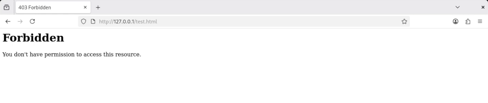
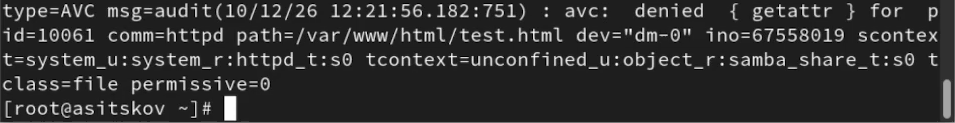
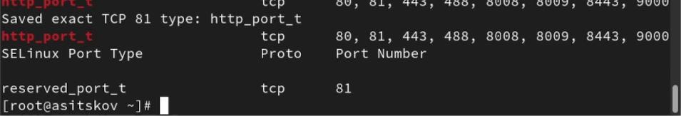
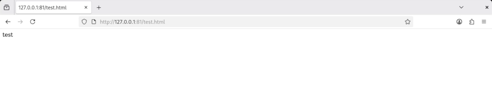

## Докладчик

**Ицков Андрей Станиславович**

Студент группы НФИбд-03-24

Российский университет дружбы народов

Основы информационной безопасности

Виртуальная машина и основная учётная запись: **asitskov**

## Предмет исследования

- **Актуальность:** разрешения файла не гарантируют доступ веб-сервера при дополнительных ограничениях SELinux.
- **Объект:** процессы, файлы и TCP-сокеты Linux.
- **Предмет:** контексты SELinux и их влияние на Apache.
- **Практическая значимость:** диагностика HTTP 403 и отказов запуска.
- Работа исследует известные механизмы; научная новизна не заявляется [@rudn_lab6].

## Цель и задачи

- Познакомиться с SELinux на примере Apache.
- Проверить контексты, переключатели и состав политики.
- Сравнить чтение страницы при двух типах файла.
- Исследовать запуск на порту 81 и события аудита.
- **Гипотеза:** доступ зависит от типа объекта при неизменных правах DAC.

## Среда и методы

- Rocky Linux 9.8, VirtualBox, ВМ asitskov.
- Apache 2.4.62, SELinux targeted, Enforcing.
- Firefox и curl внутри ВМ через 127.0.0.1.
- seinfo, semanage, ls -Z, ausearch, journalctl.
- Настройка от root, браузер от asitskov.

## Контекст безопасности

- Процесс Apache: **system_u:system_r:httpd_t:s0**.
- Страница: **unconfined_u:object_r:httpd_sys_content_t:s0**.
- Контекст: пользователь, роль, тип, уровень.
- DAC проверяет владельца, группу и ACL; SELinux проверяет разрешение взаимодействия типов [@redhat_selinux].

## Политика и каталоги

- В политике зафиксированы **5210 типов** и **15 ролей**.
- Требуемые типы httpd_t, httpd_sys_content_t и samba_share_t существуют.
- Каталог /var/www/html: root:root, **755**, базовый ACL.
- Проверки записи: root — 0; asitskov и apache — 1.
- Содержимое создаётся администратором.

## Страница на порту 80

Тип страницы **httpd_sys_content_t**, права **644**. Apache успешно возвращает содержимое.

Результат показан на @fig-slide80.

{#fig-slide80 width=90%}

## Смена типа страницы

После chcon -t samba_share_t права 644 сохранены. Ответ сервера — **403 Forbidden**.

Результат показан на @fig-slide403.

{#fig-slide403 width=90%}

## Причина отказа чтения

**AVC getattr:** httpd_t → samba_share_t, класс file, permissive=0. SELinux реально блокирует доступ.

Результат показан на @fig-slideavc.

{#fig-slideavc width=90%}

## Подготовка порта 81

81 был разрешён штатной политикой. Для опыта создана локальная замена на **reserved_port_t**.

Результат показан на @fig-slideport.

{#fig-slideport width=90%}

## Отказ привязки к порту

**AVC name_bind:** httpd_t → reserved_port_t, src=81, класс tcp_socket. Корректная конфигурация не прошла проверку политики.

Результат показан на @fig-slidebind.

{#fig-slidebind width=90%}

## Разрешение порта и файла

- semanage port -m -t http_port_t -p tcp 81 разрешил запуск.
- Apache стал active и начал слушать 81.
- При samba_share_t страница всё ещё возвращала **403**.
- chcon -t httpd_sys_content_t восстановил чтение.
- Разрешения на порт и на файл проверяются отдельно.

## Успешный запрос на 81

При Enforcing и правильных типах получены **HTTP 200** и слово **test**.

Результат показан на @fig-slide81.

{#fig-slide81 width=90%}

## Сравнение результатов

| Состояние | Результат |
| --- | --- |
| 80, httpd_sys_content_t | HTTP 200 |
| 80, samba_share_t | HTTP 403 |
| 81, reserved_port_t | отказ запуска |
| 81, http_port_t и samba_share_t | запуск, HTTP 403 |
| 81, разрешённые типы порта и файла | HTTP 200 |

: Результаты основных опытов {#tbl-slide-results}

В @tbl-slide-results сопоставлены ограничения файла и порта.

## Восстановление настроек

Исходная конфигурация и политика портов возвращены, страница удалена. Итоговый режим — **Enforcing**, Apache снова inactive.

Результат показан на @fig-sliderestore.

{#fig-sliderestore width=90%}

## Практическое значение

- HTTP 403 анализируется вместе с правами, типом файла и AVC.
- Syntax OK не гарантирует право привязки к порту.
- В name_bind важны src, tcontext и класс tcp_socket.
- В установленной политике 81 уже разрешён: изменение проверяется по локальным записям и событиям аудита.
- Общие команды администрирования сверены с документацией Apache [@redhat_httpd].

## Выводы

- SELinux ограничивает Apache дополнительно к DAC.
- Смена типа файла при правах 644 вызвала HTTP 403.
- Тип reserved_port_t запретил запуск на TCP 81.
- Разрешение порта и возврат типа страницы дали HTTP 200.
- Настройки восстановлены; цель работы достигнута.

## Источники

Методика опыта — [@rudn_lab6]. Контексты, аудит и управление политикой — [@redhat_selinux]. Конфигурация и управление Apache — [@redhat_httpd].

::: {#refs}
:::
