\newpage

```{=openxml}
<w:p><w:r><w:br w:type="page"/></w:r></w:p>
```

# Введение {.unnumbered}

## Цель работы {.unnumbered}

Получить навыки администрирования Linux и практического применения SELinux. Проверить, как мандатные ограничения влияют на доступ веб-сервера Apache к файлу и запуск сервера на выбранном TCP-порту [@rudn_lab6].

## Задание {.unnumbered}

Проверить режим и политику SELinux, контекст процессов Apache, переключатели и состав политики. Исследовать типы веб-каталогов и право создания файлов. Создать страницу test.html, проверить её чтение, изменить тип и проанализировать запрет по журналам. Исследовать запуск Apache на TCP 81 до и после разрешения порта, восстановить тип страницы, затем вернуть исходные настройки [@rudn_lab6].

Работа выполнена 12 октября 2026 года в ВМ asitskov с Rocky Linux 9.8. При правах страницы 644 смена её типа на samba_share_t привела к HTTP 403. При типе порта reserved_port_t запуск Apache на 81 был запрещён. Возврат разрешённых типов устранил оба ограничения. Результаты подтверждены записью выполнения и событиями аудита.

# Теоретическое введение

Дискреционные права определяют доступ по владельцу, группе и ACL. SELinux дополнительно проверяет взаимодействие домена процесса с типом объекта. Контекст содержит SELinux-пользователя, роль, тип и уровень. В данном опыте процесс Apache имеет домен httpd_t, статическая страница — тип httpd_sys_content_t, разрешённый веб-порт — http_port_t. Для доступа должны выполняться обе проверки [@redhat_selinux].

В режиме Enforcing нарушения блокируются и регистрируются. В Permissive они регистрируются без запрета. AVC-событие показывает исходный и целевой контексты, класс объекта и запрещённую операцию. Запрет getattr относится к получению атрибутов файла, а name_bind — к привязке сокета к порту. Отказы нужно различать по объекту и операции [@redhat_selinux].

Apache проверяет конфигурацию командой httpd -t. Управление службой в Rocky Linux осуществляется через systemctl, основные файлы находятся в /etc/httpd/conf/ и /var/log/httpd/ [@redhat_httpd].

# Выполнение лабораторной работы


## Проверка системы и SELinux

Вошёл как asitskov, перешёл к root для настройки стенда. Проверил имя хоста, выпуск ОС и загруженную политику.


```bash
whoami
hostname
cat /etc/rocky-release
sudo -i
getenforce
sestatus
grep -E '^SELINUX=|^SELINUXTYPE=' /etc/selinux/config
```


Получены Rocky Linux 9.8 (Blue Onyx), hostname asitskov.localdomain, режим Enforcing и политика targeted (@fig-environment). SELinux уже был включён; перезагрузка и перемаркировка не потребовались.


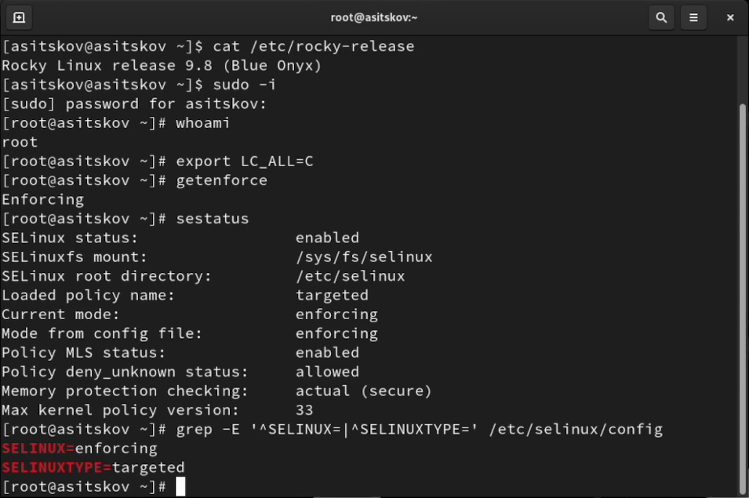{#fig-environment width=90%}


## Установка инструментов и проверка исходного состояния

Установил Apache и инструменты анализа политики, проверил справку, auditd, конфигурацию сервера, свободные порты и permissive-домены.


```bash
dnf install -y httpd policycoreutils-python-utils setools-console \
    selinux-policy-doc audit curl acl man-db util-linux
command -v httpd semanage seinfo ausearch curl getfacl script
man -w httpd_selinux
systemctl is-active auditd
httpd -t
httpd -S
ss -ltnp '( sport = :80 or sport = :81 )'
semanage permissive -l
auditctl -s
```


Программы и страница httpd_selinux доступны, auditd показывает active (@fig-tools). Веб-сервер ещё не слушал 80/81, httpd_t не входил в список permissive-доменов, аудит был включён (@fig-audit-baseline).


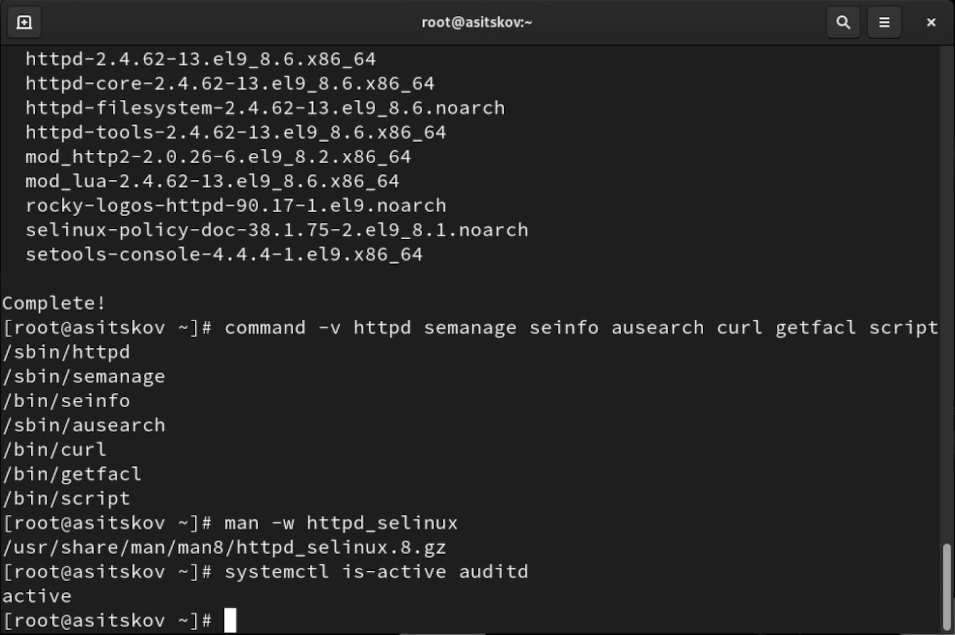{#fig-tools width=90%}


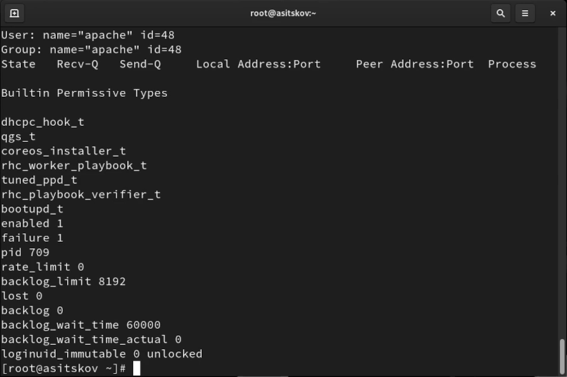{#fig-audit-baseline width=90%}


## Сохранение исходных настроек

Сохранил конфигурацию Apache, текущий режим SELinux, состояние службы и список портов. Включил запись терминала через script.


```bash
mkdir -m 700 /root/lab06-state
cp -a /etc/httpd/conf/httpd.conf /root/lab06-state/httpd.conf.before
lab06_mode_before=$(getenforce)
lab06_httpd_before=$(systemctl is-active httpd || true)
semanage port -l > /root/lab06-state/ports.before.txt
semanage port -l -C > /root/lab06-state/ports-local.before.txt
script -q -f /root/lab06-state/session.log
```


Исходный режим — Enforcing, служба до опыта — inactive. TCP 81 уже имел штатный тип http_port_t; отдельной локальной замены не было (@fig-saved-state). Подготовлен сценарий восстановления, приведённый в приложении.


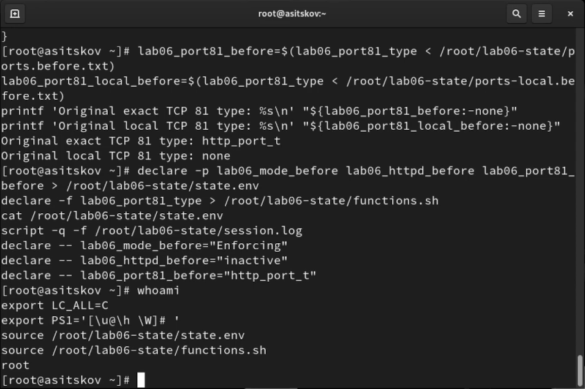{#fig-saved-state width=90%}


## Настройка и запуск Apache на порту 80

Добавил ServerName test.ru в конфигурацию, проверил синтаксис и запустил службу. Браузер и curl использовал внутри ВМ через loopback.


```bash
setenforce 1
printf '\nServerName test.ru\n' >> /etc/httpd/conf/httpd.conf
httpd -t
systemctl restart httpd
systemctl status httpd --no-pager -l
ss -ltnp '( sport = :80 )'
curl --noproxy '*' -sS -o /dev/null \
    -w 'Root page HTTP %{http_code}\n' http://127.0.0.1/
```


Служба стала active (running), процесс httpd слушал 80 (@fig-apache80). В Firefox открылась HTTP Server Test Page (@fig-welcome). Корневой запрос вернул 403 из-за стандартной welcome-конфигурации при отсутствии index.html; это отдельный результат, не отказ доступа к будущему test.html.


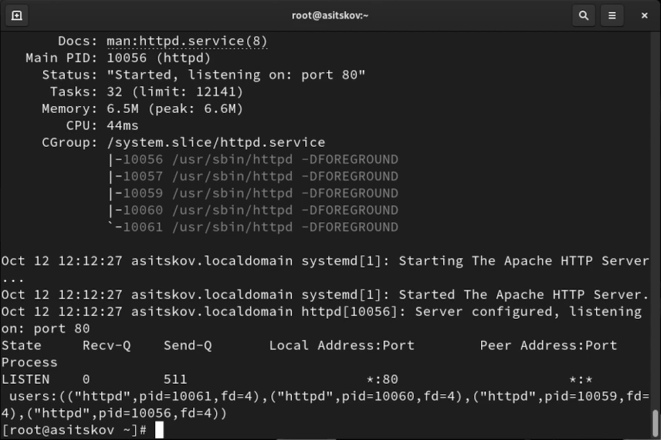{#fig-apache80 width=90%}


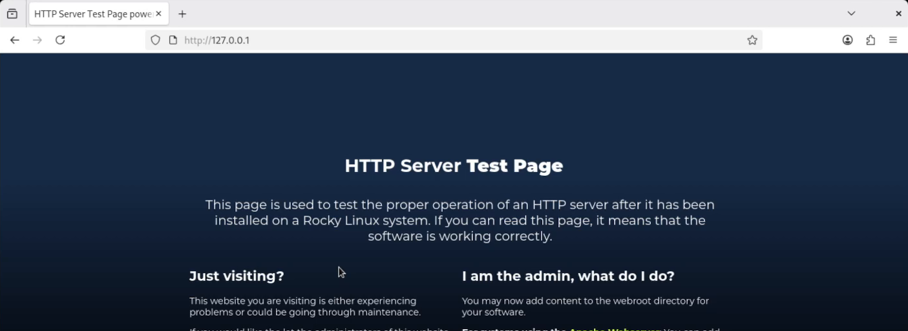{#fig-welcome width=90%}


## Контексты процессов и переключатели

Сравнил контекст оболочки с контекстами процессов сервера и просмотрел переключатели Apache.


```bash
id -Z
ps -eZ | grep '[h]ttpd'
sestatus -b | grep httpd
```


Apache работает с контекстом system_u:system_r:httpd_t:s0; оболочка root — в unconfined_t (@fig-process). Среди показанных booleans httpd_read_user_content, httpd_unified, httpd_use_cifs и httpd_use_nfs выключены (@fig-booleans). Переключатели в опыте не изменял.


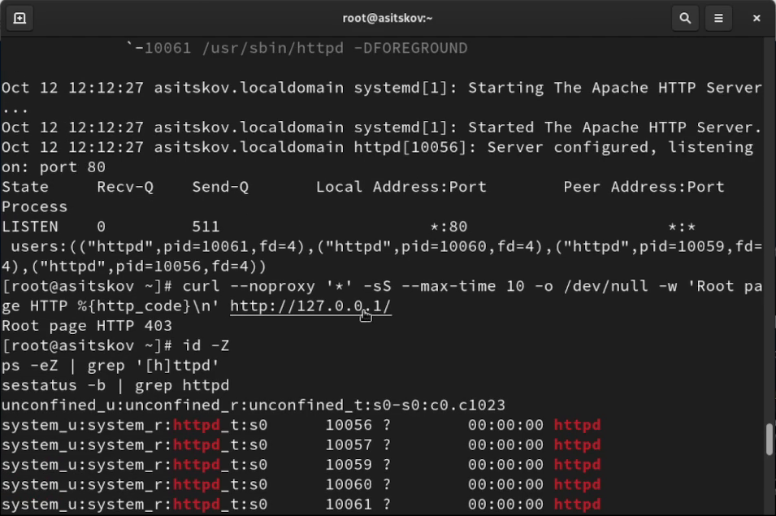{#fig-process width=90%}


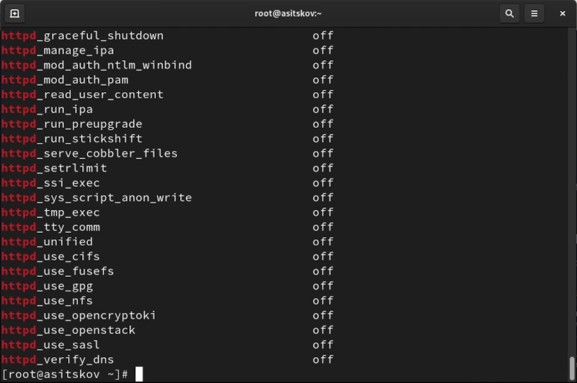{#fig-booleans width=90%}


## Статистика и состав политики

Использовал seinfo для статистики и множеств SELinux-пользователей, ролей и типов. Список типов сохранил и просмотрел через less.


```bash
seinfo
seinfo -u
seinfo -r
seinfo -t > /root/lab06-state/types.txt
less /root/lab06-state/types.txt
seinfo -t httpd_t
seinfo -t httpd_sys_content_t
seinfo -t samba_share_t
```


В списке seinfo -t зафиксировано 5210 типов (@fig-types), в seinfo -r — 15 ролей, включая object_r, system_r и unconfined_r (@fig-roles). Среди пользователей видны staff_u, sysadm_u, system_u, unconfined_u, user_u, xguest_u. Отдельные запросы подтвердили httpd_t, httpd_sys_content_t и samba_share_t (@fig-required-types). Эти сведения относятся к установленной версии политики.


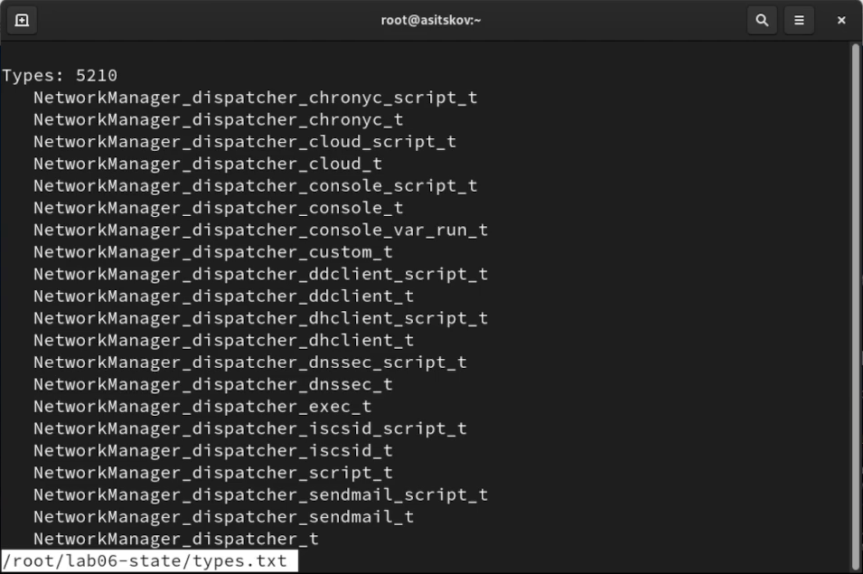{#fig-types width=90%}


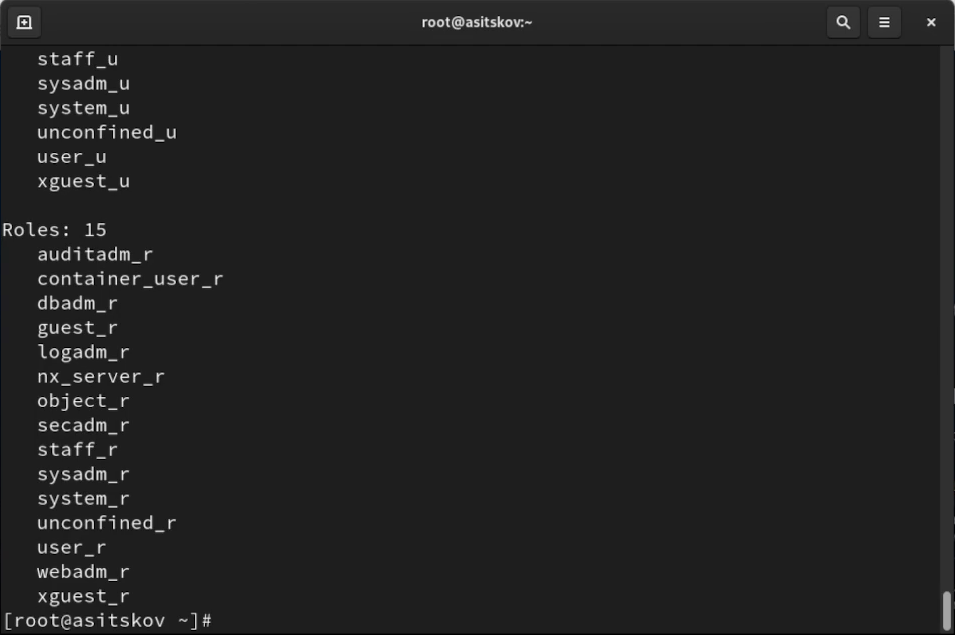{#fig-roles width=90%}


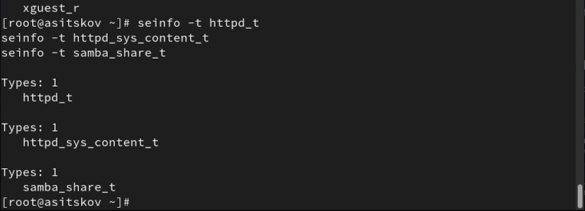{#fig-required-types width=90%}


## Контексты каталогов и право создавать файлы

Просмотрел /var/www и /var/www/html, проверил владельца, режим, ACL и право записи для root, asitskov и apache.


```bash
ls -ldZ /var/www /var/www/html
ls -lZ /var/www
ls -lZ /var/www/html
getfacl -p /var/www/html
stat -c 'mode=%a owner=%U group=%G' /var/www/html
test -w /var/www/html; echo "root write check: $?"
runuser -u asitskov -- test -w /var/www/html
echo "asitskov write check: $?"
runuser -u apache -- test -w /var/www/html
echo "apache write check: $?"
```


/var/www/html имеет тип httpd_sys_content_t, владельца root:root и режим 755. В /var/www у cgi-bin тип httpd_sys_script_exec_t, у html — httpd_sys_content_t. HTML-каталог первоначально пуст. ACL содержит только базовые разрешения. Проверка записи root дала 0, asitskov и apache — 1 (@fig-directory). Создавать файл в этой конфигурации может root; обычным пользователям запись не предоставлена.


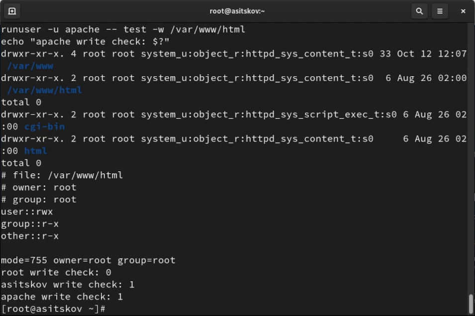{#fig-directory width=90%}


## Создание страницы и успешное чтение на 80

Создал файл от root непосредственно в веб-каталоге, установил режим 644 и проверил его контекст, содержимое и HTTP-ответ.


```bash
umask 022
cat > /var/www/html/test.html <<'EOF'
<html>
<body>test</body>
</html>
EOF
chmod 644 /var/www/html/test.html
cat /var/www/html/test.html
ls -lZ /var/www/html/test.html
curl --noproxy '*' -sS -i http://127.0.0.1/test.html
```


Новый файл получил контекст unconfined_u:object_r:httpd_sys_content_t:s0, владельца root:root и права 644. Сервер Apache/2.4.62 вернул HTTP/1.1 200 OK и 33 байта HTML (@fig-page200). Firefox показал test по адресу http://127.0.0.1/test.html (@fig-browser80).


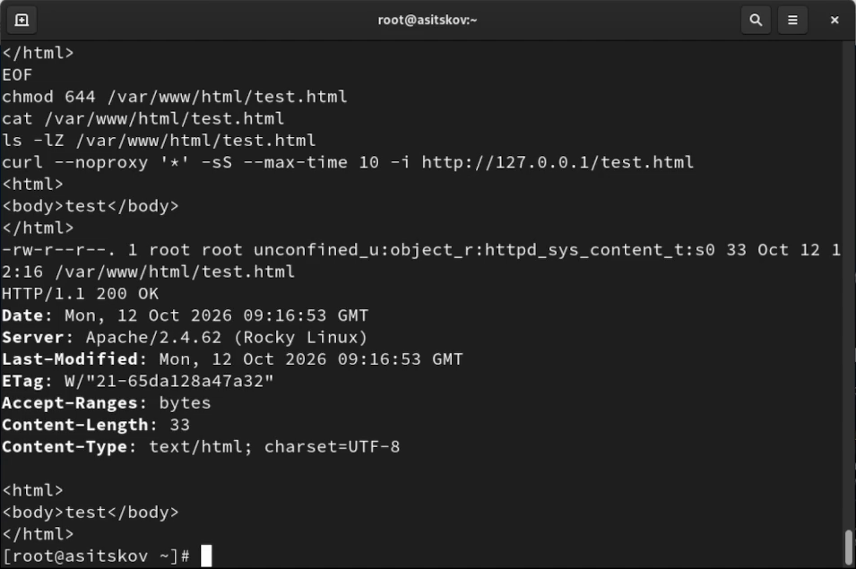{#fig-page200 width=90%}


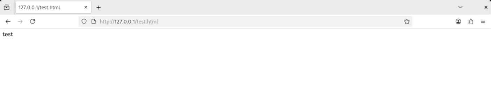{#fig-browser80 width=90%}


## Справка по типам файлов Apache

Открыл man httpd_selinux и сопоставил описание типов с созданной страницей.


```bash
man httpd_selinux
ls -Z /var/www/html/test.html
```


В справке просмотрены httpd_sys_rw_content_t для содержимого с чтением и записью (@fig-man-content), httpd_config_t для конфигурации (@fig-man-config) и httpd_log_t для журналов (@fig-man-log). Во время одного из поисков появилось Pattern not found; затем продолжил просмотр страницы. Тип созданного test.html, проверенный через ls -Z, — httpd_sys_content_t, то есть статическое читаемое веб-содержимое [@redhat_selinux]. Его object_r — роль файлового объекта, а unconfined_u — SELinux-пользователь, отличный от владельца root в DAC.


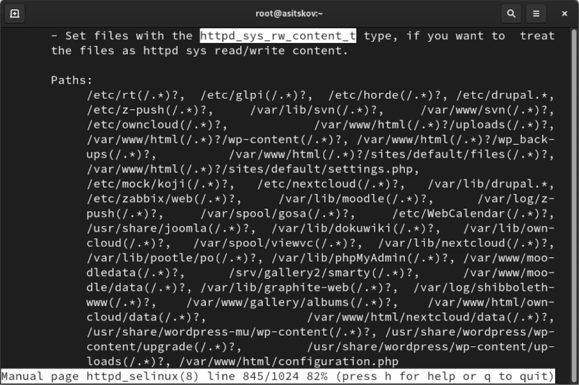{#fig-man-content width=90%}


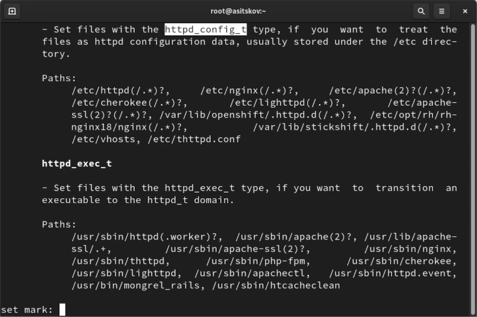{#fig-man-config width=90%}


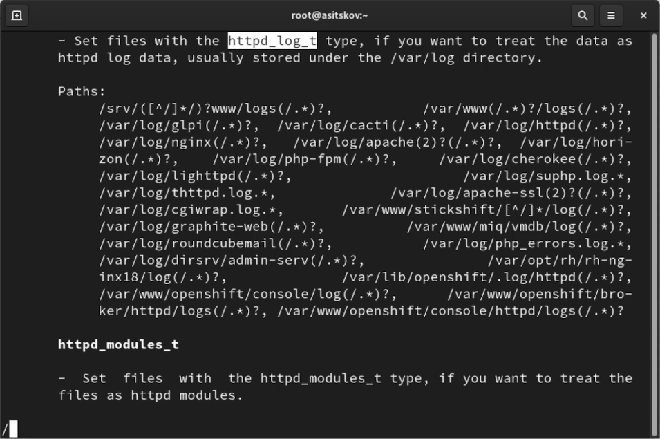{#fig-man-log width=90%}


## Смена типа страницы и Forbidden

Изменил только тип файла на samba_share_t. Повторил запрос curl и обновил ту же страницу в Firefox без кэша.


```bash
chcon -t samba_share_t /var/www/html/test.html
ls -lZ /var/www/html/test.html
getenforce
curl --noproxy '*' -sS -i http://127.0.0.1/test.html
```


Права остались -rw-r--r--, но запрос вернул HTTP/1.1 403 Forbidden (@fig-samba403); браузер показал Forbidden (@fig-browser403). Следовательно, обычного разрешения чтения файла недостаточно для процесса httpd_t при этом типе объекта.


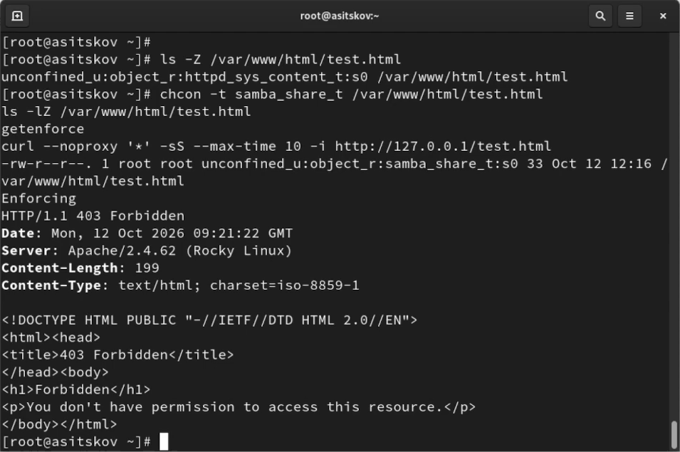{#fig-samba403 width=90%}


{#fig-browser403 width=90%}


## Анализ журналов отказа доступа к файлу

Просмотрел журналы Apache, сообщения systemd, системный журнал и события аудита для процесса httpd.


```bash
tail -n 10 /var/log/httpd/access_log
tail -n 10 /var/log/httpd/error_log
journalctl -u httpd --since '-5 minutes' --no-pager
tail -n 15 /var/log/messages
systemctl is-active auditd
pgrep -a -x auditd
pgrep -a -f '[s]etroubleshootd'
ausearch -m AVC,USER_AVC -c httpd -ts recent -i
```


Зафиксировано avc: denied { getattr }, comm=httpd, path=/var/www/html/test.html, scontext=system_u:system_r:httpd_t:s0, tcontext=unconfined_u:object_r:samba_share_t:s0, tclass=file, permissive=0 (@fig-file-avc). Это реальный запрет SELinux. auditd работал; setroubleshootd в одной проверке ещё не работал, затем в системных сообщениях появились его пояснения. Дополнительное отключение dontaudit не понадобилось.


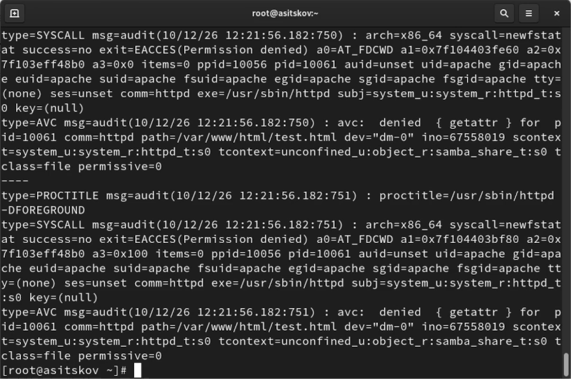{#fig-file-avc width=90%}


## Подготовка политики для запрещённого порта 81

Штатная политика уже разрешала TCP 81 для Apache. Чтобы проверить запрет на указанном в методичке порту, создал временную локальную замену его типа.


```bash
semanage port -l | grep '^http_port_t[[:space:]]'
semanage port -m -t reserved_port_t -p tcp 81
semanage port -l -C
```


Локальный список показал reserved_port_t tcp 81 (@fig-port-denied). Общий список продолжал показывать также базовую запись 81 в http_port_t. Факт применения локальной замены далее подтверждён AVC с целевым типом reserved_port_t; одного общего списка для такой проверки недостаточно.


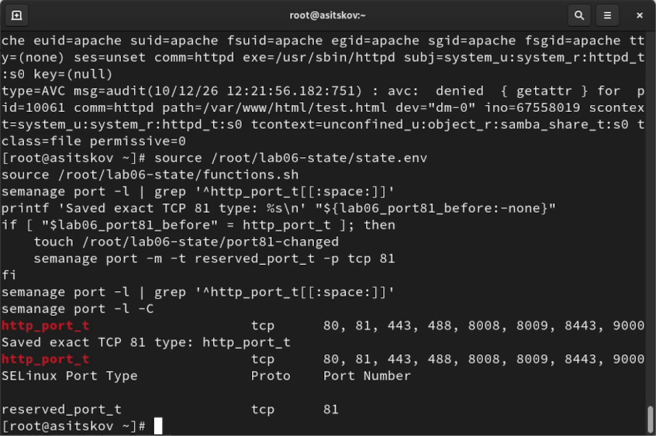{#fig-port-denied width=90%}


## Отказ запуска Apache на порту 81

Заменил Listen 80 на Listen 81, проверил синтаксис и попытался перезапустить сервер.


```bash
sed -i 's/^Listen 80$/Listen 81/' /etc/httpd/conf/httpd.conf
grep -n '^Listen ' /etc/httpd/conf/httpd.conf
httpd -t
systemctl restart httpd
echo "restart exit code: $?"
systemctl status httpd --no-pager -l
journalctl -u httpd --since '-5 minutes' --no-pager
tail -n 15 /var/log/httpd/error_log
tail -n 10 /var/log/httpd/access_log
tail -n 15 /var/log/messages
ausearch -m AVC,USER_AVC -c httpd -ts recent -i
```


Несмотря на Syntax OK, restart завершился кодом 1, служба получила failed (@fig-start-failed). В аудите — denied { name_bind }, src=81, домен httpd_t, целевой тип reserved_port_t, класс tcp_socket и permissive=0 (@fig-bind-avc). Причина — запрет привязки к порту, а не синтаксическая ошибка или занятость порта. Access_log регистрирует запросы; новые сведения о неудачном запуске следует искать в error_log, journal и audit.


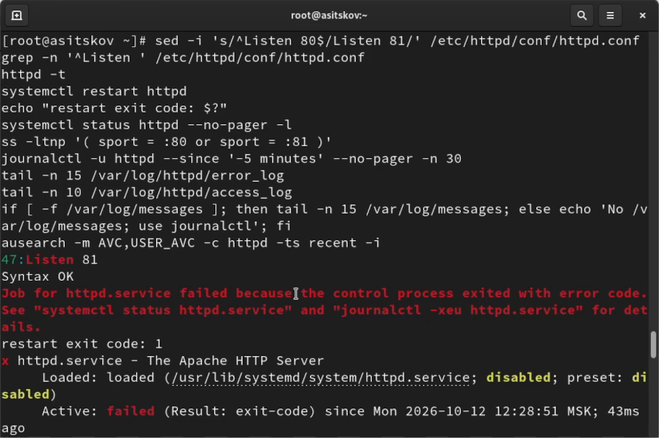{#fig-start-failed width=90%}


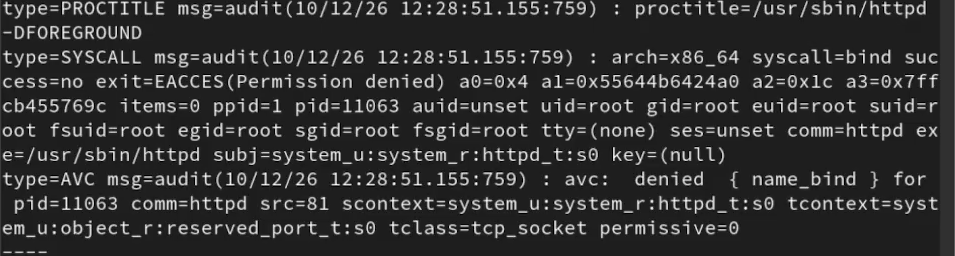{#fig-bind-avc width=90%}


## Разрешение порта и запуск сервера

Вернул порту 81 тип http_port_t через изменение уже существующей записи и снова запустил службу.


```bash
semanage port -m -t http_port_t -p tcp 81
semanage port -l -C
systemctl reset-failed httpd
systemctl start httpd
systemctl status httpd --no-pager -l
ss -ltnp '( sport = :81 )'
ls -Z /var/www/html/test.html
curl --noproxy '*' -sS -i http://127.0.0.1:81/test.html
```


Apache стал active (running) и начал слушать 81 (@fig-start81). Страница пока оставалась samba_share_t, поэтому сервер отвечал 403 (@fig-file403-on81). Разрешение порта устраняет запрет запуска, но не меняет разрешения на файл.


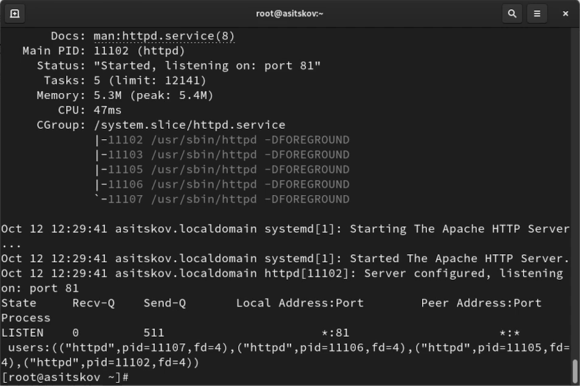{#fig-start81 width=90%}


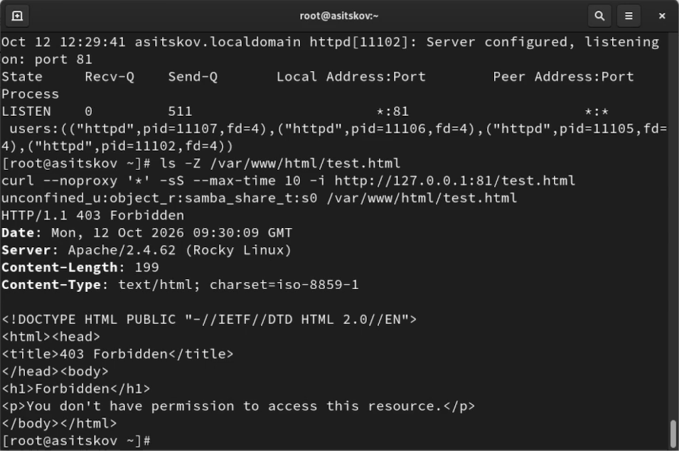{#fig-file403-on81 width=90%}


## Восстановление типа страницы и успешное чтение на 81

Вернул странице тип httpd_sys_content_t, повторил запрос и открыл адрес с явным портом 81 в Firefox.


```bash
chcon -t httpd_sys_content_t /var/www/html/test.html
ls -lZ /var/www/html/test.html
getenforce
curl --noproxy '*' -sS -i http://127.0.0.1:81/test.html
tail -n 10 /var/log/httpd/access_log
```


При сохранённом Enforcing сервер вернул HTTP/1.1 200 OK (@fig-page81). Firefox отобразил test (@fig-browser81). В access_log последовательность статусов 403 → 200 подтверждает изменение результата чтения (@fig-access-log); записи о favicon.ico с 404 не относятся к основной странице.


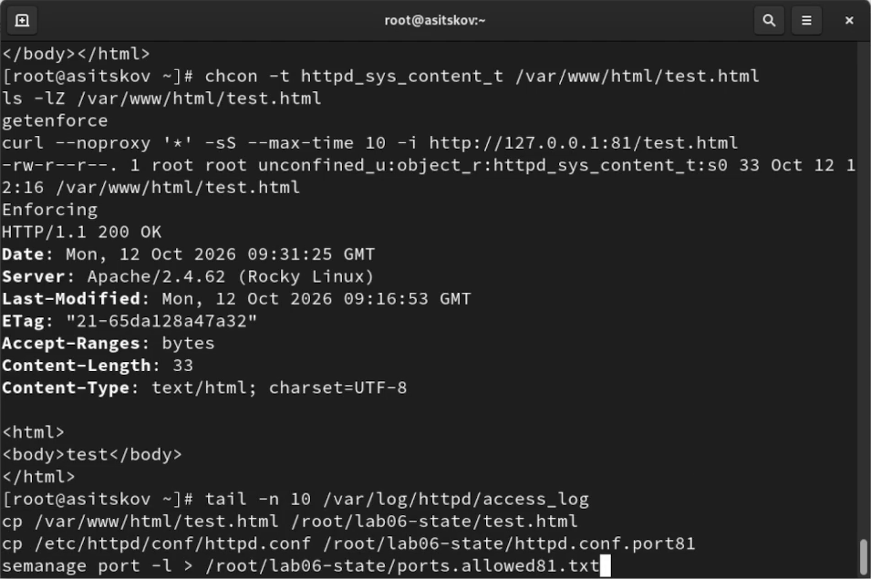{#fig-page81 width=90%}


{#fig-browser81 width=90%}


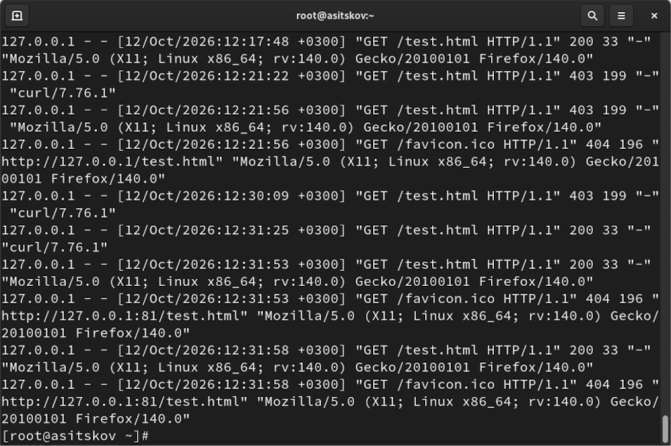{#fig-access-log width=90%}


## Возврат порта 80 и удаление страницы

Вернул Listen 80, перезапустил сервер, удалил локальную настройку TCP 81, сравнил политику с исходной и удалил test.html.


```bash
sed -i 's/^Listen 81$/Listen 80/' /etc/httpd/conf/httpd.conf
httpd -t
systemctl restart httpd
semanage port -d -p tcp 81
semanage port -l -C
semanage port -l > /root/lab06-state/ports.restored.txt
diff -u /root/lab06-state/ports.before.txt \
    /root/lab06-state/ports.restored.txt
command rm /var/www/html/test.html
test ! -e /var/www/html/test.html
echo "test.html removed check: $?"
curl --noproxy '*' -sS -i http://127.0.0.1/test.html
```


diff не вывел различий, проверка удаления дала 0, запрос на 80 вернул 404 Not Found (@fig-removed). TCP 81 остался в базовой политике http_port_t, как до работы; удалена именно временная локальная замена. Это корректное восстановление установленного стенда.


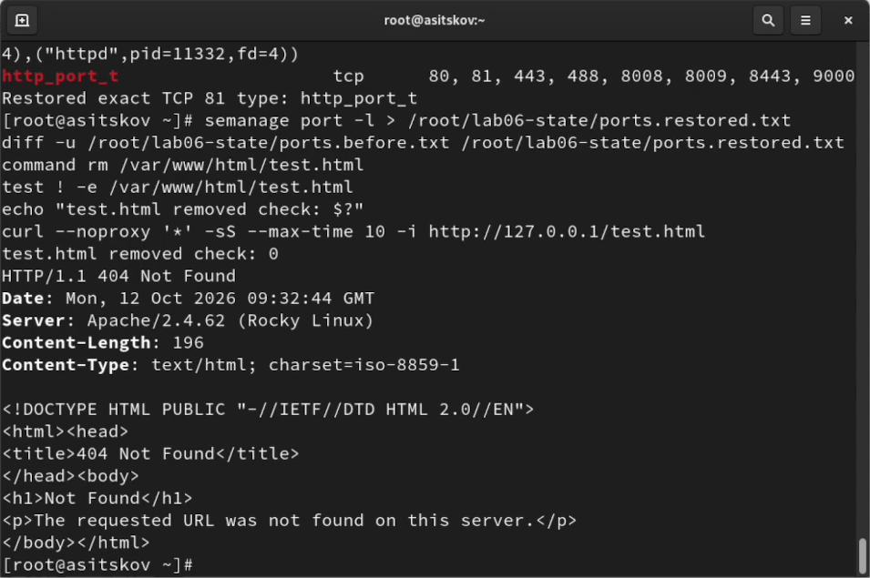{#fig-removed width=90%}


## Окончательное восстановление и сохранение материалов

Сохранил журналы, восстановил резервную конфигурацию и исходную активность службы, завершил script и собрал архив материалов.


```bash
bash /root/lab06-state/restore.sh
cmp /root/lab06-state/httpd.conf.before /etc/httpd/conf/httpd.conf
getenforce
systemctl is-active httpd
ss -ltnp '( sport = :80 or sport = :81 )'
test ! -e /var/www/html/test.html
exit
tar -C /home/asitskov -czf /home/asitskov/lab06-evidence.tar.gz \
    lab06-evidence
ls -lh /home/asitskov/lab06-evidence.tar.gz
```


Первая попытка сценария остановилась на reset-failed для уже неактивного выгруженного unit. Проверку заменил условием is-failed и повторил восстановление. Получены Syntax OK, RESTORED и Enforcing (@fig-restored). Конфигурация совпала с резервной; служба возвращена к inactive, порты свободны, тестовый файл отсутствует. В ВМ создан lab06-evidence.tar.gz размером около 49 КБ, владелец asitskov; завершение — в обычной учётной записи (@fig-archive).


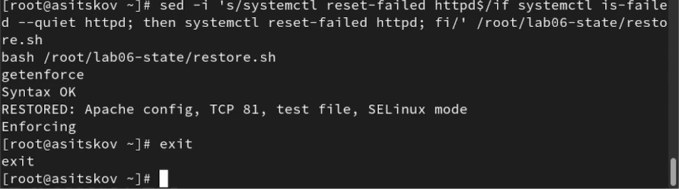{#fig-restored width=90%}


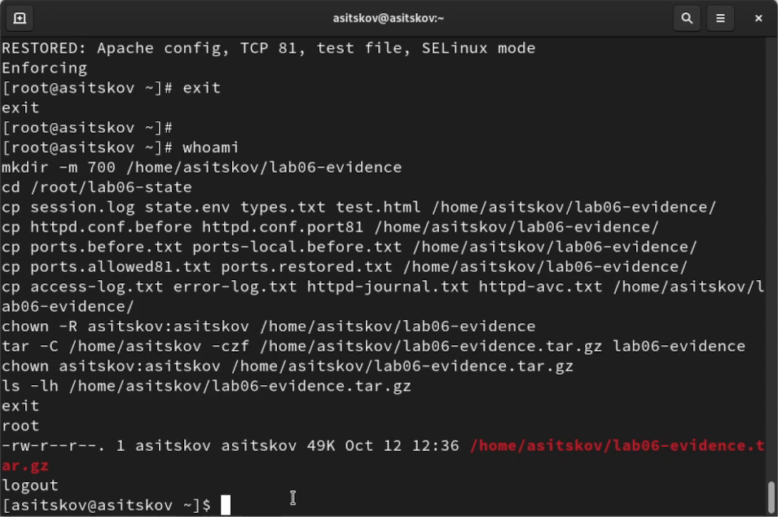{#fig-archive width=90%}


# Обобщение результатов

Основные переходы состояния приведены в @tbl-results.

| Порт сервера | Тип страницы | Тип TCP 81 | Результат |
| --- | --- | --- | --- |
| 80 | httpd_sys_content_t | исходный http_port_t | HTTP 200 |
| 80 | samba_share_t | исходный http_port_t | HTTP 403, AVC getattr |
| попытка 81 | samba_share_t | reserved_port_t | запуск запрещён, AVC name_bind |
| 81 | samba_share_t | http_port_t | сервер работает, HTTP 403 |
| 81 | httpd_sys_content_t | http_port_t | HTTP 200 |
| 80 перед остановкой | файл удалён | исходная политика | HTTP 404 |

: Результаты доступа и запуска Apache {#tbl-results}

Первый запрет относится к файловому объекту, второй — к TCP-сокету. Устранение одного запрета не снимает другой. Права 644 сохранялись при успешном и неуспешном чтении; поведение изменялось после смены SELinux-типа.

# Особенности установленного стенда

Методичка рассчитана на CentOS с прежней конфигурацией. В Rocky Linux 9.8 использованы /etc/httpd/conf/httpd.conf, systemctl и журналы /var/log/httpd/. Опечатки в sestatus, имени auditd, tail и типе страницы исправлены в командах.

TCP 81 уже входил в штатную политику, поэтому сначала выполнена локальная замена на reserved_port_t. Разрешение вернулось через semanage port -m, а восстановление исходной политики — через удаление локальной записи. Применение semanage port -a к уже существующей отдельной записи было бы неверным. Фактические события name_bind подтвердили действие замены.

Отдельных контрольных вопросов и домашнего задания в методичке нет. Объяснения отказов включены в анализ соответствующих опытов.

# Выводы

Проверил SELinux targeted в Enforcing и исследовал домен Apache, контексты каталогов, переключатели и состав политики. При правах страницы 644 тип samba_share_t вызвал HTTP 403 и AVC getattr. Локальный тип reserved_port_t запретил привязку httpd_t к TCP 81, что подтверждено AVC name_bind.

После разрешения порта сервер запустился, но доступ к странице восстановился только после возврата httpd_sys_content_t. Получены HTTP 200 и слово test на порту 81. Это показывает независимость ограничений на файл и на порт. Исходная конфигурация, политика портов, режим Enforcing и неактивное состояние Apache восстановлены; тестовая страница удалена.

# Список литературы {.unnumbered}

::: {#refs}
:::

# Приложение {.unnumbered}

## Содержимое тестовой страницы {.unnumbered}

```html
<html>
<body>test</body>
</html>
```

## Изменения Apache в опыте {.unnumbered}

В исходном конфигурационном файле изменялась строка Listen, а в конец добавлялось имя сервера. После работы восстановлена резервная копия всего файла.

```apache
Listen 81
ServerName test.ru
```

## Исправленный сценарий восстановления {.unnumbered}

Сценарий использует сохранённый state.env и функцию извлечения отдельной записи TCP 81. Полная копия сценария включена в каталог code комплекта.


```bash
#!/bin/bash
set -e
export LC_ALL=C
source /root/lab06-state/state.env
source /root/lab06-state/functions.sh
systemctl stop httpd
cp -a /root/lab06-state/httpd.conf.before /etc/httpd/conf/httpd.conf
if [ -f /root/lab06-state/port81-changed ]; then
    local_type=$(semanage port -l -C | lab06_port81_type)
    if [ -n "$local_type" ]; then
        semanage port -d -p tcp 81
    fi
fi
if [ -f /root/lab06-state/dontaudit-disabled ]; then
    semodule -B
    command rm /root/lab06-state/dontaudit-disabled
fi
if [ -f /root/lab06-state/test-created ]; then
    command rm -f /var/www/html/test.html
fi
httpd -t
if [ "$lab06_httpd_before" = active ]; then
    systemctl start httpd
else
    if systemctl is-failed --quiet httpd; then
        systemctl reset-failed httpd
    fi
fi
case "$lab06_mode_before" in
    Enforcing) setenforce 1 ;;
    Permissive) setenforce 0 ;;
    *) echo 'STOP: invalid saved SELinux mode'; exit 1 ;;
esac
echo 'RESTORED: Apache config, TCP 81, test file, SELinux mode'
```
