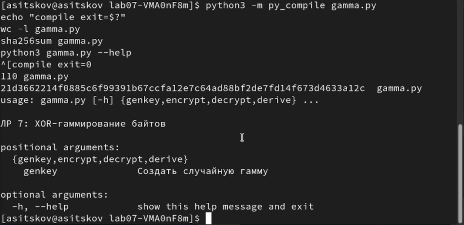
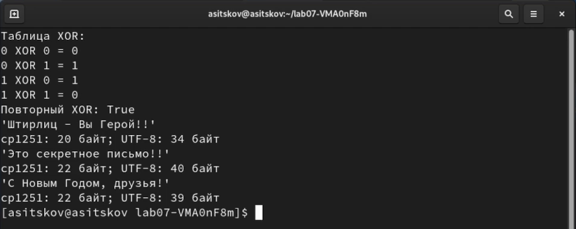
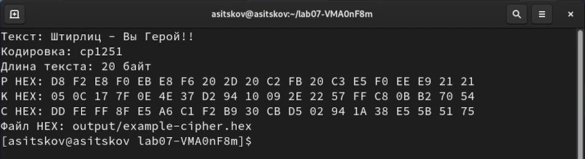
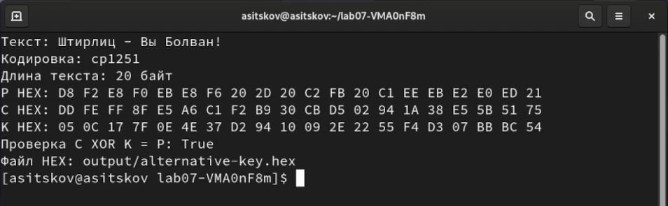
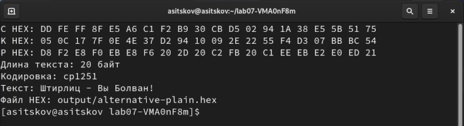
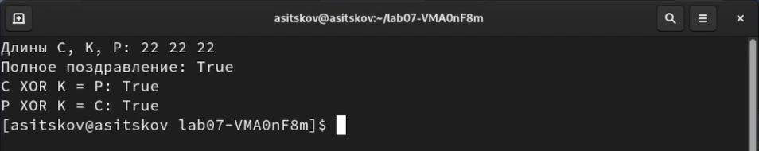
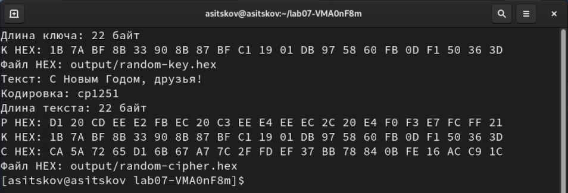
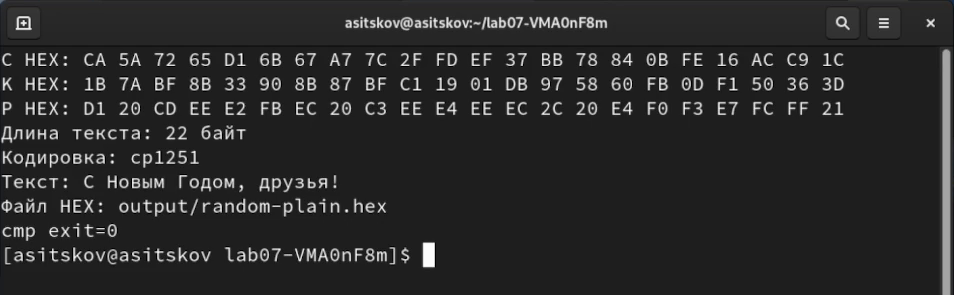

## Докладчик

**Ицков Андрей Станиславович**

Студент группы НФИбд-03-24

Российский университет дружбы народов

Основы информационной безопасности

Виртуальная машина и учётная запись: **asitskov**

## Предмет исследования

- **Актуальность:** корректное представление данных необходимо для обратимого шифрования.
- **Объект:** текстовые сообщения и ключевые последовательности.
- **Предмет:** побайтовый XOR и однократная гамма.
- **Практическое значение:** проверка обратимости и требований к ключу.
- Работа исследует известный алгоритм. Научная новизна не заявляется [@rudn_lab7].

## Цель и задачи

Освоить однократное гаммирование.

- Реализовать C = P XOR K и обратное преобразование.
- Найти K для заданных C и выбранного P.
- Получить «С Новым Годом, друзья!» полностью.
- Проверить длины и операции по сохранённым файлам.

**Гипотеза:** для любого текста длиной с C можно вычислить согласованный ключ K = C XOR P.

## Материалы и методы

- Rocky Linux 9.8, Python 3.9.25, VirtualBox.
- ВМ и пользователь asitskov.
- Текстовые данные в cp1251, исходник в UTF-8.
- argparse для команд, secrets для новой гаммы.
- HEX-файлы и побайтовая таблица.
- Проверки по записи выполнения 12 октября 2026 года.

## Принцип гаммирования

Шифрование: **C = P XOR K**

Расшифрование: **P = C XOR K**

Вычисление ключа: **K = C XOR P**

| A | B | A XOR B |
| :---: | :---: | :---: |
| 0 | 0 | 0 |
| 0 | 1 | 1 |
| 1 | 0 | 1 |
| 1 | 1 | 0 |

: Таблица XOR {#tbl-slide-xor}

В @tbl-slide-xor одинаковые биты дают 0. Поэтому (P XOR K) XOR K = P [@rudn_lab7].

## Приложение

- encrypt вычисляет шифротекст.
- decrypt восстанавливает текст.
- derive находит ключ для выбранного прочтения.
- genkey создаёт новую гамму нужной длины.
- Проверка длин выполняется **до zip**.
- --out сохраняет HEX и предотвращает перезапись.

Интерфейс реализован через argparse [@python_argparse].

## Проверка исходника

Компиляция завершилась с кодом **0**. Исходник содержит **110 строк**; контрольная сумма совпала.

Результат показан на @fig-slide-code.

{#fig-slide-code width=70%}

## Кодировка и длины

Пример методички: **20 байт**. Полное поздравление: **22 байта cp1251**. Размеры UTF-8 отличаются [@python_codecs].

Результат показан на @fig-slide-lengths.

{#fig-slide-lengths width=80%}

## Шифрование примера

По известным P и K вычислен C. Все 20 байт совпали с методичкой.

Результат показан на @fig-slide-example.

{#fig-slide-example width=90%}

## Расшифрование исходным ключом

Повторный XOR восстановил **«Штирлиц - Вы Герой!!»**.

Результат показан на @fig-slide-decrypt.

{#fig-slide-decrypt width=90%}

## Альтернативный ключ

При неизменном C вычислен ключ для **«Штирлиц - Вы Болван!»**. Проверка дала **True**.

Результат показан на @fig-slide-alternative-key.

{#fig-slide-alternative-key width=90%}

## Другое прочтение

Тот же шифротекст с другим ключом дал другой полный текст. Возможное прочтение не устанавливает подлинный текст отправителя.

Результат показан на @fig-slide-alternative.

{#fig-slide-alternative width=90%}

## Исходные данные для поздравления

В задании не указан отдельный 22-байтовый C. Создал его из **«Это секретное письмо!!»** и нового учебного ключа.

Результат показан на @fig-slide-task.

{#fig-slide-task width=65%}

## Контроль несовпадения длин

Для C длиной 20 байт и P длиной 22 байта приложение вернуло **код 2**. Усечённый результат не создаётся.

Результат показан на @fig-slide-error.

{#fig-slide-error width=90%}

## Ключ для поздравления

K = C XOR P вычислен для всех **22 позиций**. Проверка C XOR K = P дала **True**.

Результат показан на @fig-slide-greeting-key.

{#fig-slide-greeting-key width=90%}

## Требуемое сообщение

Найденный ключ превратил неизменный task-cipher.hex в **«С Новым Годом, друзья!»**.

Результат показан на @fig-slide-greeting.

{#fig-slide-greeting width=90%}

## Побайтовый расчёт

| Позиция | C HEX | P HEX | K HEX |
| ---: | :---: | :---: | :---: |
| 1 | CD | D1 | 1C |
| 2 | C0 | 20 | E0 |
| 10 | D1 | EE | 3F |
| 21 | BB | FF | 44 |
| 22 | 9D | 21 | BC |

: Фрагмент таблицы вычисления ключа {#tbl-slide-key}

В @tbl-slide-key **K = C XOR P** для каждой позиции.

Полная таблица содержит 22 строки и приведена в отчёте.

## Проверка результата

Длины C, K, P: **22/22/22**. Полное совпадение текста и оба обратных равенства дали **True**.

Результат показан на @fig-slide-roundtrip.

{#fig-slide-roundtrip width=90%}

## Новая случайная гамма

secrets.token_bytes создал **22 новых байта**. Поздравление зашифровано отдельным ключом [@python_secrets].

Результат показан на @fig-slide-random.

{#fig-slide-random width=90%}

## Расшифрование случайной гаммой

Восстановлено полное поздравление. Сравнение файлов завершилось с **cmp exit=0**.

Результат показан на @fig-slide-random-decrypt.

{#fig-slide-random-decrypt width=90%}

## Условия стойкости

- Гамма секретная и независимая от сообщения.
- В идеальном блокноте она истинно и равномерно случайная.
- Длина применяемой гаммы равна длине сообщения.
- Для нового сообщения нужен новый ключ.
- XOR сам по себе не проверяет целостность.

Фиксированные ключи демонстрируют вычисления. Генератор ОС не доказывает теоретическую идеальную случайность [@rudn_lab7; @python_secrets].

## Выводы

- Приложение выполняет три преобразования через один XOR.
- Пример методички полностью воспроизведён.
- Найден ключ для полного поздравления длиной 22 байта.
- Обратные проверки прошли, несовпадение длин отвергнуто.
- Случайная гамма также восстановила исходные данные.
- Цель работы достигнута.

## Источники

::: {#refs}
:::
