\newpage

```{=openxml}
<w:p><w:r><w:br w:type="page"/></w:r></w:p>
```

# Введение {.unnumbered}

## Цель работы {.unnumbered}

Освоить на практике применение режима однократного гаммирования [@rudn_lab7].

## Задание {.unnumbered}

Разработать приложение, определяющее шифротекст по известным открытому тексту и ключу, а также ключ для преобразования заданного шифротекста в выбранный текст. Получить сообщение «С Новым Годом, друзья!» и проверить обратное преобразование. Ответить на восемь контрольных вопросов [@rudn_lab7].

Работу выполнил 12 октября 2026 года в Rocky Linux 9.8, Python 3.9.25, под пользователем asitskov. Воспроизвёл пример методички, вычислил ключ для полного поздравления и подтвердил расшифрование. Длины сообщения, ключа и шифротекста составили 22 байта. Для случайной гаммы повторная проверка также восстановила исходный текст.

# Теоретическое введение

Гаммирование накладывает последовательность байтов ключа на байты сообщения операцией XOR. Для каждой позиции выполняются равенства $C_i=P_i\oplus K_i$, $P_i=C_i\oplus K_i$, $K_i=C_i\oplus P_i$. XOR означает сложение битов по модулю 2. Операция коммутативна и ассоциативна, $A\oplus A=0$, $A\oplus0=A$, поэтому повторное применение ключа возвращает исходные данные [@rudn_lab7].

Идеальный одноразовый блокнот использует секретную равномерно случайную гамму, независимую от сообщения и равную ему по длине. Один участок ключа применяется для шифрования только одного сообщения. Повторное применение при расшифровании этого же сообщения необходимо для восстановления данных. Фиксированные учебные ключи позволяют проверить вычисления, но не демонстрируют абсолютную стойкость. Генератор ОС обеспечивает криптографически пригодные случайные байты; это не доказательство теоретической идеальной случайности [@rudn_lab7; @python_secrets].

В приложении текст кодируется в cp1251, соответствующую HEX-байтам русского примера методички. Исходник Python и текстовые HEX-файлы сохраняются в UTF-8. Это разные уровни представления данных. Обычный ASCII не содержит русских букв; для XOR используются байты выбранной кодировки, а не номера символов Unicode [@python_codecs].

# Выполнение лабораторной работы


## Проверка окружения

Открыл Terminal в ВМ asitskov. Проверил текущего пользователя, имя хоста, выпуск ОС и инструменты. Установка дополнительных пакетов не потребовалась.

```bash
whoami
hostname
cat /etc/rocky-release
python3 --version
command -v python3 script tar sha256sum
```

Получены asitskov, asitskov.localdomain, Rocky Linux 9.8 (Blue Onyx) и Python 3.9.25. Все четыре программы найдены в /usr/bin (@fig-environment).

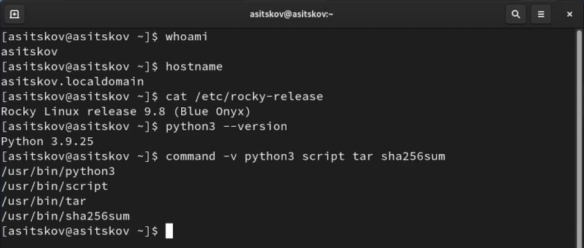{#fig-environment width=95%}


## Рабочая папка и журнал

Создал отдельную папку, каталоги входов и результатов. Включил запись терминальной сессии через script.

```bash
LAB07_DIR="$(mktemp -d "$HOME/lab07-XXXXXXXX")"
cd -- "$LAB07_DIR"
pwd
mkdir input output evidence
export PYTHONIOENCODING=utf-8
script -q -f session.log
pwd
whoami
```

Текущий путь — /home/asitskov/lab07-VMA0nF8m, пользователь — asitskov. Журнал записывается в session.log (@fig-workdir).

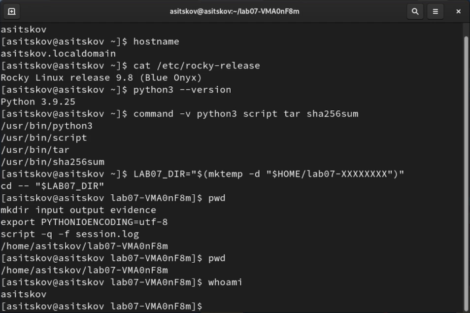{#fig-workdir width=95%}


## Реализация приложения

Создал gamma.py многострочной командой cat с завершающей строкой PY. Полный исходник приведён в приложении. Интерфейс команд построен на argparse [@python_argparse]. Режим encrypt кодирует текст и вычисляет шифротекст, decrypt выполняет обратную операцию, derive вычисляет ключ по известным шифротексту и выбранному тексту, genkey генерирует заданное число байтов. Параметр --table показывает каждую позицию, --out сохраняет результат в HEX-файл.

Одна функция xor_bytes реализует все три преобразования. Перед zip она сравнивает длины и возвращает ошибку при несовпадении. Без этой проверки zip мог бы молча отбросить хвост более длинного аргумента. Создание результата в режиме x предотвращает случайную перезапись готового файла.

```python
def xor_bytes(left, right):
    if len(left) != len(right):
        raise ValueError(
            "Длины не совпадают: {} и {} байт".format(len(left), len(right))
        )
    return bytes(a ^ b for a, b in zip(left, right))
```


## Проверка исходника и справки

После сохранения программы проверил её синтаксис, размер и контрольную сумму, затем открыл справку.

```bash
python3 -m py_compile gamma.py
echo "compile exit=$?"
wc -l gamma.py
sha256sum gamma.py
python3 gamma.py --help
```

Код завершения компиляции — 0, файл содержит 110 строк. Справка перечисляет genkey, encrypt, decrypt и derive; SHA-256 совпал с подготовленным исходником (@fig-code).

{#fig-code width=95%}


Контрольная сумма программы:

```text
21d3662214f0885c6f99391b67ccfa12e7c6
4ad88bf2de7fd14f673d4633a12c
```

В блоке сумма перенесена на две строки для верстки; полное значение содержит 64 шестнадцатеричные цифры без пробела и переноса.


## XOR и длина кодированного текста

Проверил таблицу XOR, самоуничтожение ключа при повторной операции и длины трёх строк в двух кодировках.

```bash
python3 - <<'PY'
print('Таблица XOR:')
for a, b in ((0, 0), (0, 1), (1, 0), (1, 1)):
    print(a, 'XOR', b, '=', a ^ b)
print('Повторный XOR:', (0xD8 ^ 0x05) ^ 0x05 == 0xD8)
for text in ('Штирлиц - Вы Герой!!', 'Это секретное письмо!!',
             'С Новым Годом, друзья!'):
    print(repr(text))
    print('cp1251:', len(text.encode('cp1251')), 'байт;',
          'UTF-8:', len(text.encode('utf-8')), 'байт')
PY
```

Получены значения XOR 0, 1, 1, 0 и True при повторном наложении. Длины cp1251/UTF-8: 20/34 для примера, 22/40 для исходного текста задания, 22/39 для поздравления (@fig-lengths).

{#fig-lengths width=95%}


## Шифрование примера методички

Сохранил ключ Центра в input/center-key.hex. В тексте использовал обычный дефис: HEX 2D в методичке обозначает именно его, хотя в печатной фразе стоит тире.

```bash
cat > input/center-key.hex <<'EOF'
05 0C 17 7F 0E 4E 37 D2 94 10 09 2E 22 57 FF C8 0B B2 70 54
EOF
python3 gamma.py encrypt --text 'Штирлиц - Вы Герой!!' \
    --key-file input/center-key.hex --out output/example-cipher.hex
```

Шифротекст длиной 20 байт совпал с примером на с. 46 методички: DD FE FF 8F E5 A6 C1 F2 B9 30 CB D5 02 94 1A 38 E5 5B 51 75 (@fig-example-encrypt).

{#fig-example-encrypt width=95%}


## Обратное преобразование примера

Применил исходный ключ к сохранённому шифротексту.

```bash
python3 gamma.py decrypt --data-file output/example-cipher.hex \
    --key-file input/center-key.hex --out output/example-plain.hex
```

Получен исходный текст «Штирлиц - Вы Герой!!» и его исходные байты (@fig-example-decrypt).

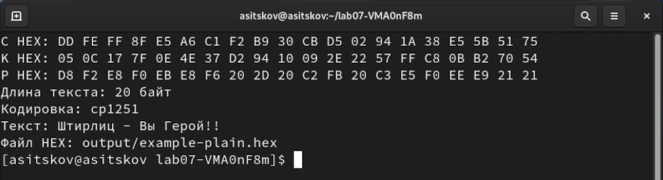{#fig-example-decrypt width=95%}


## Вычисление альтернативного ключа

Оставил шифротекст неизменным, выбрал второе прочтение «Штирлиц - Вы Болван!» и вычислил K = C XOR P.

```bash
python3 gamma.py derive --data-file output/example-cipher.hex \
    --text 'Штирлиц - Вы Болван!' --out output/alternative-key.hex
```

Проверка C XOR K = P дала True. Вычисленный ключ совпал с альтернативным ключом методички: 05 0C 17 7F 0E 4E 37 D2 94 10 09 2E 22 55 F4 D3 07 BB BC 54 (@fig-alternative-key).

{#fig-alternative-key width=95%}


## Проверка альтернативного прочтения

Расшифровал тот же файл с найденным ключом.

```bash
python3 gamma.py decrypt --data-file output/example-cipher.hex \
    --key-file output/alternative-key.hex --out output/alternative-plain.hex
```

Получен текст «Штирлиц - Вы Болван!». При разных ключах один шифротекст соответствует разным сообщениям той же длины; такой расчёт сам по себе не устанавливает подлинный текст отправителя (@fig-alternative-decrypt).

{#fig-alternative-decrypt width=95%}


## Уточнение исходных данных задания

Поздравление «С Новым Годом, друзья!» содержит 22 байта cp1251, а приведённый ранее шифротекст — 20 байт. В разделе 7.3 методички конкретный шифротекст для поздравления отдельно не задан [@rudn_lab7]. Поскольку XOR сохраняет длину, использовать прежние 20 байт для полной фразы невозможно. Для задания выбрал отдельный исходный текст той же длины «Это секретное письмо!!» и новый фиксированный учебный ключ. Далее преобразовывал неизменный 22-байтовый шифротекст. Поздравление не обрезал, исходный пример не дополнял произвольными байтами.


## Шифротекст длиной 22 байта

Создал input/demo-key.hex, зашифровал новый исходный текст и выполнил его обратное преобразование.

```bash
cat > input/demo-key.hex <<'EOF'
10 32 54 76 98 BA DC FE 01 23 45 67 89 AB CD EF 12 34 56 78 9A BC
EOF
python3 gamma.py encrypt --text 'Это секретное письмо!!' \
    --key-file input/demo-key.hex --out output/task-cipher.hex
python3 gamma.py decrypt --data-file output/task-cipher.hex \
    --key-file input/demo-key.hex --out output/task-original.hex
```

Получен C = CD C0 BA 56 69 5F 36 0E E4 D1 A8 89 6C 8B 22 07 E3 C8 BA 96 BB 9D. Обратная операция вернула «Это секретное письмо!!» (@fig-task-cipher).

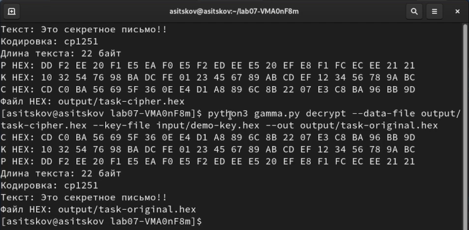{#fig-task-cipher width=95%}


## Проверка несовпадения длин

Попытался вычислить ключ для полного поздравления по исходному 20-байтовому примеру. Это контролируемая проверка обработки неправильных входных данных.

```bash
python3 gamma.py derive --data-file output/example-cipher.hex \
    --text 'С Новым Годом, друзья!'
echo "expected error exit=$?"
```

Программа сообщила «Длины не совпадают: 20 и 22 байт» и завершилась с кодом 2. Она не вернула усечённый результат (@fig-length-error).

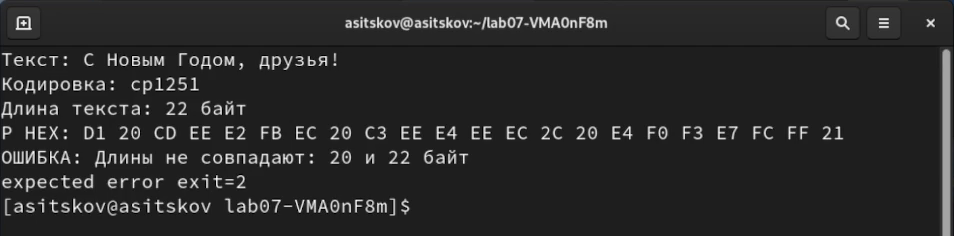{#fig-length-error width=95%}


## Ключ для полного поздравления

Использовал новый 22-байтовый шифротекст и точное поздравление как желаемый открытый текст.

```bash
python3 gamma.py derive --data-file output/task-cipher.hex \
    --text 'С Новым Годом, друзья!' --out output/greeting-key.hex
```

Получен ключ 1C E0 77 B8 8B A4 DA 2E 27 3F 4C 67 80 A7 02 E3 13 3B 5D 6A 44 BC. Проверка C XOR K = P дала True (@fig-greeting-key).

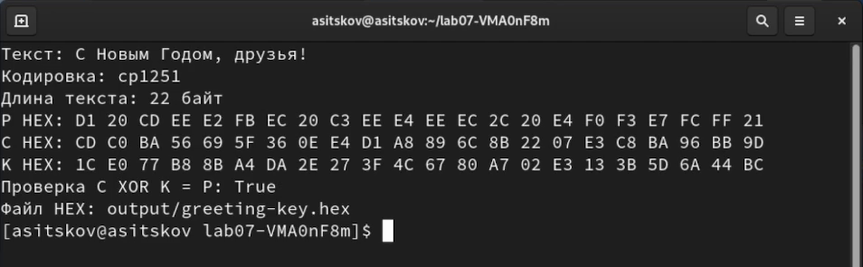{#fig-greeting-key width=95%}


## Получение требуемого сообщения

Применил найденный ключ к тому же task-cipher.hex.

```bash
python3 gamma.py decrypt --data-file output/task-cipher.hex \
    --key-file output/greeting-key.hex --out output/greeting-plain.hex
```

Получена точная строка «С Новым Годом, друзья!» длиной 22 байта. Выполнено требование раздела 7.3 (@fig-greeting-decrypt).

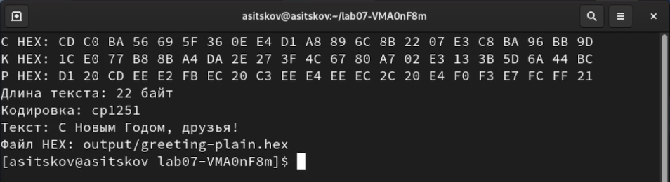{#fig-greeting-decrypt width=95%}


## Побайтовый расчёт ключа

Сохранил таблицу всех 22 позиций и показал её двумя частями.

```bash
python3 gamma.py derive --data-file output/task-cipher.hex \
    --text 'С Новым Годом, друзья!' --table > evidence/greeting-table.txt
sed -n '1,18p' evidence/greeting-table.txt
sed -n '19,40p' evidence/greeting-table.txt
```

Первая часть показана на @fig-table-first, продолжение — на @fig-table-second. Для первой позиции CD XOR D1 = 1C, для последней 9D XOR 21 = BC. Полный расчёт представлен в @tbl-greeting.


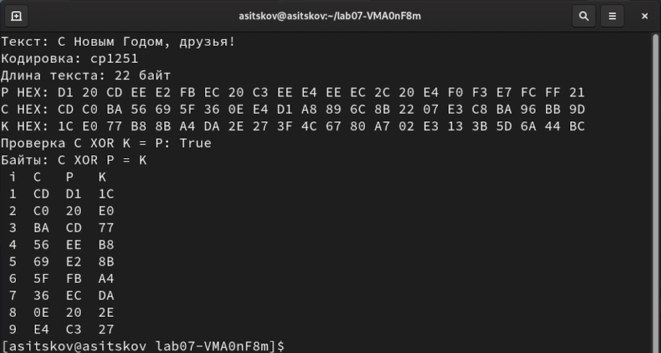{#fig-table-first width=95%}


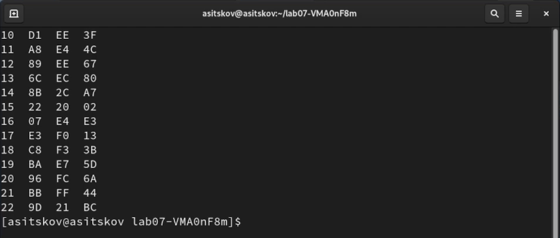{#fig-table-second width=95%}


\newpage

```{=openxml}
<w:p><w:r><w:br w:type="page"/></w:r></w:p>
```

| Позиция | C HEX | P HEX | K HEX |
| ---: | :---: | :---: | :---: |
| 1 | CD | D1 | 1C |
| 2 | C0 | 20 | E0 |
| 3 | BA | CD | 77 |
| 4 | 56 | EE | B8 |
| 5 | 69 | E2 | 8B |
| 6 | 5F | FB | A4 |
| 7 | 36 | EC | DA |
| 8 | 0E | 20 | 2E |
| 9 | E4 | C3 | 27 |
| 10 | D1 | EE | 3F |
| 11 | A8 | E4 | 4C |
| 12 | 89 | EE | 67 |
| 13 | 6C | EC | 80 |
| 14 | 8B | 2C | A7 |
| 15 | 22 | 20 | 02 |
| 16 | 07 | E4 | E3 |
| 17 | E3 | F0 | 13 |
| 18 | C8 | F3 | 3B |
| 19 | BA | E7 | 5D |
| 20 | 96 | FC | 6A |
| 21 | BB | FF | 44 |
| 22 | 9D | 21 | BC |

: Побайтовое вычисление ключа для поздравления {#tbl-greeting}


## Проверка сохранённых байтов

Прочитал файлы C, K и P и проверил длины, совпадение с точным поздравлением и оба обратных равенства.

```bash
python3 - <<'PY'
from pathlib import Path
def read_hex(name):
    return bytes.fromhex(Path(name).read_text(encoding='utf-8'))
c = read_hex('output/task-cipher.hex')
k = read_hex('output/greeting-key.hex')
p = read_hex('output/greeting-plain.hex')
target = 'С Новым Годом, друзья!'.encode('cp1251')
print('Длины C, K, P:', len(c), len(k), len(p))
print('Полное поздравление:', p == target)
print('C XOR K = P:', bytes(a ^ b for a, b in zip(c, k)) == target)
print('P XOR K = C:', bytes(a ^ b for a, b in zip(p, k)) == c)
assert len(c) == len(k) == len(p) == 22
assert p == target
assert bytes(a ^ b for a, b in zip(p, k)) == c
PY
```

Получены длины 22, 22, 22 и три значения True; assert не вызвал ошибок (@fig-roundtrip).

{#fig-roundtrip width=95%}


## Генерация случайной гаммы

Создал отдельный ключ из 22 байт через secrets.token_bytes и зашифровал поздравление. Генератор получает случайность от ОС [@python_secrets].

```bash
python3 gamma.py genkey --length 22 --out output/random-key.hex
python3 gamma.py encrypt --text 'С Новым Годом, друзья!' \
    --key-file output/random-key.hex --out output/random-cipher.hex
```

В этом запуске K = 1B 7A BF 8B 33 90 8B 87 BF C1 19 01 DB 97 58 60 FB 0D F1 50 36 3D; C = CA 5A 72 65 D1 6B 67 A7 7C 2F FD EF 37 BB 78 84 0B FE 16 AC C9 1C. Длины — по 22 байта (@fig-random-encrypt).

{#fig-random-encrypt width=95%}


## Расшифрование со случайной гаммой

Восстановил текст из random-cipher.hex и сравнил его байты с ранее полученным поздравлением.

```bash
python3 gamma.py decrypt --data-file output/random-cipher.hex \
    --key-file output/random-key.hex --out output/random-plain.hex
cmp output/greeting-plain.hex output/random-plain.hex
echo "cmp exit=$?"
```

Получена та же точная фраза; cmp завершился с кодом 0. Новую гамму применил для шифрования только этого сообщения (@fig-random-decrypt).

{#fig-random-decrypt width=95%}


## Завершение журнала и проверка файлов

Вышел из оболочки script, проверил программу, журнал и состав материалов.

```bash
exit
pwd
whoami
ls -lh gamma.py session.log
find input output evidence -maxdepth 1 -type f | sort
```

В той же папке остались исходник 4,2 КБ, журнал 32 КБ, 2 входных HEX-файла, 11 выходных и таблица (@fig-files).

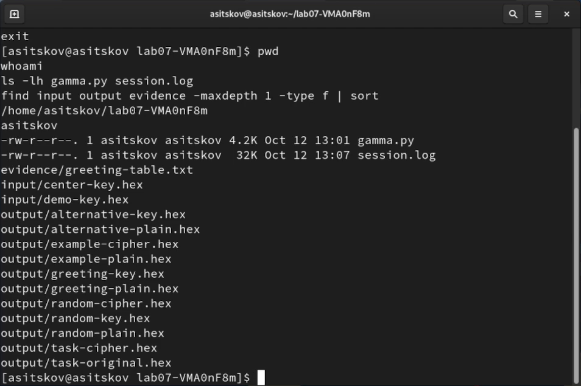{#fig-files width=95%}


## Архив материалов в ВМ

После завершения журнала собрал исходник, входы, выходы и таблицу в архив и проверил его содержимое.

```bash
tar -czf lab07-evidence.tar.gz gamma.py session.log input output evidence
tar -tzf lab07-evidence.tar.gz
sha256sum lab07-evidence.tar.gz
ls -lh lab07-evidence.tar.gz
```

Архив lab07-evidence.tar.gz создан в /home/asitskov/lab07-VMA0nF8m, размер в выводе — 6,1 КБ. Список tar содержит все материалы и журнал (@fig-archive).

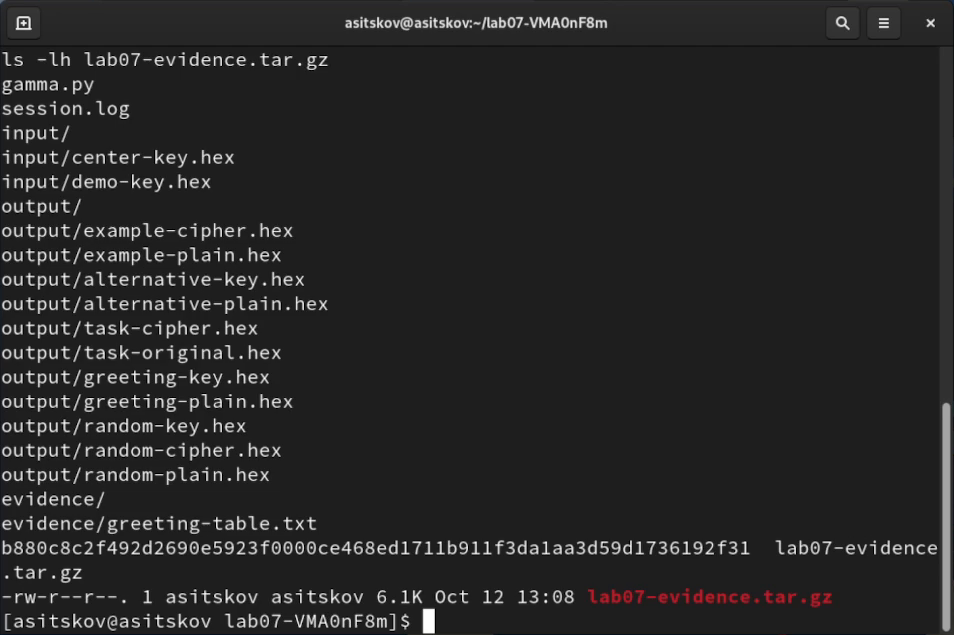{#fig-archive width=95%}


# Ответы на контрольные вопросы

## Смысл однократного гаммирования

Каждый байт открытого текста складывается по модулю 2 с соответствующим байтом гаммы. Для восстановления выполняется XOR с той же гаммой. Однократность относится к шифрованию разных сообщений: для нового сообщения нужен новый независимый ключ [@rudn_lab7].

## Недостатки метода

Длинный ключ требуется тайно передать и надёжно хранить. Нужен учёт использованных участков, поскольку повторный ключ создаёт связь между сообщениями. Сам XOR не защищает целостность: изменение бита шифротекста изменяет тот же бит расшифрованного текста. Поэтому правильное преобразование данных не означает проверки их подлинности.

## Преимущества метода

Шифрование и расшифрование используют простую быструю операцию. При секретном независимом равномерно случайном одноразовом ключе нужной длины обеспечивается информационная стойкость. Это свойство относится к идеальному одноразовому блокноту [@rudn_lab7].

## Равенство длин открытого текста и ключа

Каждому байту сообщения соответствует отдельный байт применяемой гаммы. Короткая гамма не покрывает сообщение полностью; повторение короткого ключа нарушает однократность. В реализации любое несовпадение длин отвергается. Более длинный запас случайного материала можно разделить на непересекающиеся участки, но применяемый участок должен иметь длину сообщения.

## Операция и её особенности

Используется XOR, сложение битов по модулю 2. Результат равен 1 при разных битах и 0 при одинаковых. Операция ассоциативна и коммутативна, A XOR A = 0, A XOR 0 = A. Поэтому (P XOR K) XOR K = P [@rudn_lab7].

## Шифротекст по открытому тексту и ключу

Сначала преобразую строку в байты согласованной кодировки. Затем вычисляю C[i] = P[i] XOR K[i] для каждой позиции. Шифротекст имеет ту же длину; показываю его в HEX, поскольку произвольные байты не обязаны быть печатными символами [@rudn_lab7; @python_codecs].

## Ключ по открытому тексту и шифротексту

Вычисляю K[i] = C[i] XOR P[i]. Для известного фрагмента можно получить только соответствующий фрагмент ключа. Если текст лишь выбран как возможное прочтение, расчёт даёт согласованный с ним ключ, но не доказывает, что отправитель действительно использовал этот текст [@rudn_lab7].

## Условия абсолютной стойкости

Ключ должен быть секретным, независимым от сообщения, истинно и равномерно случайным, длиной с сообщение. Он используется для шифрования единственного сообщения. Ключ от криптографического генератора ОС полезен для практики, но успешная расшифровка не доказывает выполнение теоретического требования идеальной случайности [@rudn_lab7; @python_secrets].

# Выводы

Разработал приложение с шифрованием, расшифрованием и вычислением ключа через побайтовый XOR. Воспроизвёл оба прочтения примера методички. Для отдельного 22-байтового шифротекста вычислил ключ и получил точное сообщение «С Новым Годом, друзья!». Проверки файлов подтвердили длины 22/22/22, C XOR K = P и P XOR K = C. При несовпадении 20/22 приложение вернуло ошибку вместо обрезки. Отдельная случайная гамма также восстановила поздравление. Цель работы достигнута.

# Список литературы {.unnumbered}

::: {#refs}
:::

# Приложение с исходным кодом

Файл gamma.py содержит 110 строк. При проверке в ВМ получен тот же SHA-256, что у публикуемого исходника.

```python
import argparse
import secrets
import sys
from pathlib import Path


def hex_text(data):
    return " ".join("{:02X}".format(value) for value in data)


def load_hex(path):
    data = bytes.fromhex(Path(path).read_text(encoding="utf-8"))
    if not data:
        raise ValueError("Пустой HEX-файл: " + path)
    return data


def xor_bytes(left, right):
    if len(left) != len(right):
        raise ValueError(
            "Длины не совпадают: {} и {} байт".format(len(left), len(right))
        )
    return bytes(a ^ b for a, b in zip(left, right))


def save_hex(path, data):
    if path:
        with open(path, "x", encoding="utf-8") as stream:
            stream.write(hex_text(data) + "\n")
        print("Файл HEX:", path)


def show_table(left, right, result, labels):
    print("Байты: {} XOR {} = {}".format(*labels))
    print(" i  {}   {}   {}".format(*labels))
    for i, values in enumerate(zip(left, right, result), 1):
        print("{:2d}  {:02X}  {:02X}  {:02X}".format(i, *values))


def main():
    parser = argparse.ArgumentParser(description="ЛР 7: XOR-гаммирование байтов")
    commands = parser.add_subparsers(dest="command", required=True)
    genkey = commands.add_parser("genkey", help="Создать случайную гамму")
    genkey.add_argument("--length", type=int, required=True)
    genkey.add_argument("--out", required=True)
    for command in ("encrypt", "decrypt", "derive"):
        item = commands.add_parser(command)
        if command in ("encrypt", "derive"):
            item.add_argument("--text", required=True)
            item.add_argument("--encoding", default="cp1251")
        if command in ("decrypt", "derive"):
            item.add_argument("--data-file", required=True)
        if command in ("encrypt", "decrypt"):
            item.add_argument("--key-file", required=True)
        if command == "decrypt":
            item.add_argument("--encoding", default="cp1251")
        item.add_argument("--out")
        item.add_argument("--table", action="store_true")
    args = parser.parse_args()
    if args.command == "genkey":
        if args.length <= 0:
            raise ValueError("Длина ключа должна быть положительной")
        result = secrets.token_bytes(args.length)
        print("Длина ключа:", len(result), "байт")
        print("K HEX:", hex_text(result))
        save_hex(args.out, result)
        return
    if args.command in ("encrypt", "derive"):
        plain = args.text.encode(args.encoding)
        if not plain:
            raise ValueError("Пустой открытый текст")
        print("Текст:", args.text)
        print("Кодировка:", args.encoding)
        print("Длина текста:", len(plain), "байт")
        print("P HEX:", hex_text(plain))
    if args.command == "encrypt":
        key = load_hex(args.key_file)
        result = xor_bytes(plain, key)
        left, right, labels = plain, key, ("P", "K", "C")
        print("K HEX:", hex_text(key))
        print("C HEX:", hex_text(result))
    elif args.command == "decrypt":
        cipher = load_hex(args.data_file)
        key = load_hex(args.key_file)
        result = xor_bytes(cipher, key)
        left, right, labels = cipher, key, ("C", "K", "P")
        print("C HEX:", hex_text(cipher))
        print("K HEX:", hex_text(key))
        print("P HEX:", hex_text(result))
        print("Длина текста:", len(result), "байт")
        print("Кодировка:", args.encoding)
        print("Текст:", result.decode(args.encoding))
    else:
        cipher = load_hex(args.data_file)
        result = xor_bytes(cipher, plain)
        left, right, labels = cipher, plain, ("C", "P", "K")
        print("C HEX:", hex_text(cipher))
        print("K HEX:", hex_text(result))
        print("Проверка C XOR K = P:", xor_bytes(cipher, result) == plain)
    save_hex(args.out, result)
    if args.table:
        show_table(left, right, result, labels)


if __name__ == "__main__":
    try:
        main()
    except (ValueError, OSError, LookupError) as error:
        print("ОШИБКА:", error, file=sys.stderr)
        sys.exit(2)
```
