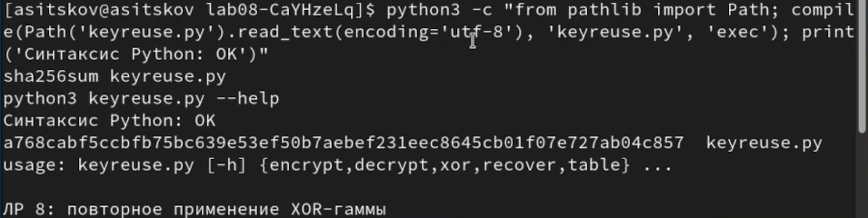
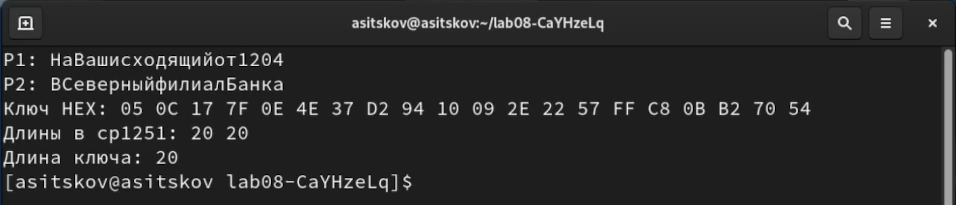
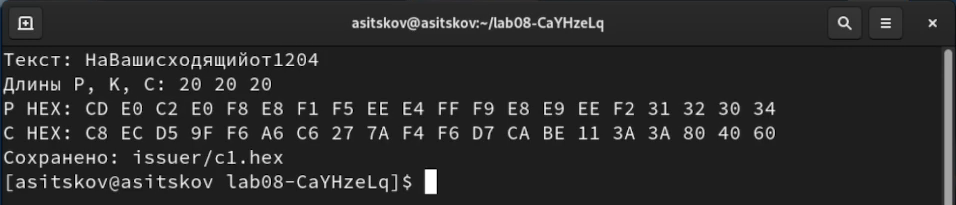
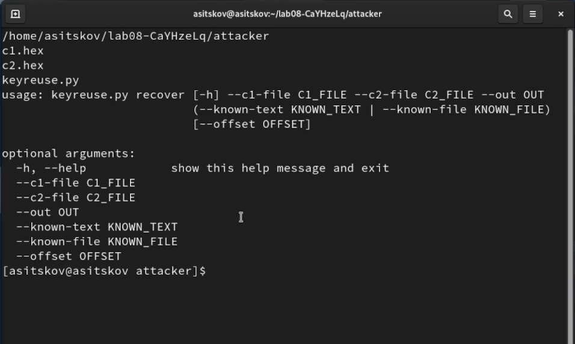
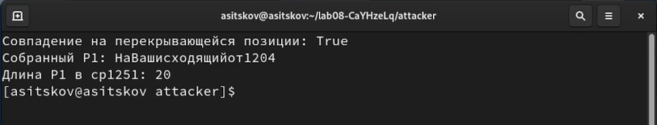
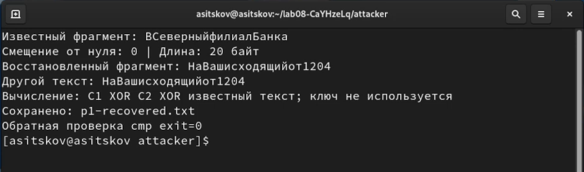
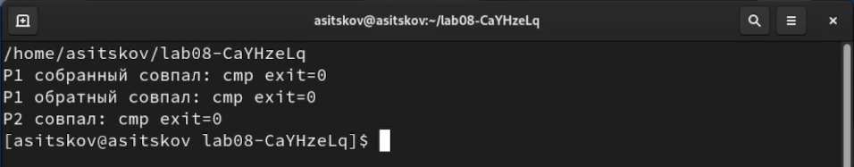
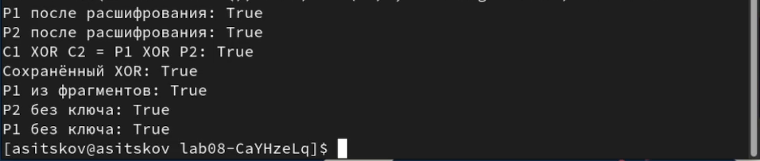

## Докладчик

**Ицков Андрей Станиславович**

Студент группы НФИбд-03-24

Российский университет дружбы народов

Основы информационной безопасности

Виртуальная машина и учётная запись: **asitskov**

## Предмет исследования

- **Актуальность:** повторение гаммы раскрывает связь между сообщениями.
- **Объект:** две телеграммы, зашифрованные одним ключом.
- **Предмет:** исключение ключа через XOR шифротекстов.
- **Практическое значение:** выявление ошибок использования ключей.
- Исследуется известный алгоритм; научная новизна не заявляется [@rudn_lab8].

## Цель и задачи

Освоить гаммирование разных текстов одним ключом.

- Получить два шифротекста и проверить расшифрование.
- Выразить способ исключения гаммы аналитически.
- Прочитать сообщения по шаблону и смысловой гипотезе.
- Проверить совпадение с исходными данными.

**Гипотеза:** при повторении гаммы известные позиции одного текста раскрывают те же позиции другого.

## Материалы и методы

- Rocky Linux 9.8, Python 3.9.25, VirtualBox.
- ВМ, hostname и пользователь: asitskov.
- XOR байтов, текст в cp1251, файлы в UTF-8 [@python_codecs; @python_bytes].
- Пять режимов приложения, интерфейс argparse [@python_argparse].
- Две телеграммы и ключ по 20 байт.
- Таблица и побайтовые сравнения сохранённых файлов.

## Исключение повторённой гаммы

$$C_1=P_1\oplus K,\qquad C_2=P_2\oplus K$$

$$C_1\oplus C_2=P_1\oplus P_2$$

$$P_2=C_1\oplus C_2\oplus P_1$$

Ключ сокращается, поскольку **K XOR K = 0**.

Известный фрагмент раскрывает соответствующие позиции другого текста [@rudn_lab8].

## Приложение

- **encrypt / decrypt:** преобразование с ключом.
- **xor:** связь двух открытых текстов без ключа.
- **recover:** другой текст по известному фрагменту.
- **table:** проверка равенства по всем позициям.
- Строгая проверка длин и запрет перезаписи.
- В исходнике нет встроенных телеграмм и ключа.

## Проверка программы

Проверка синтаксиса завершилась успешно. SHA-256 исходника совпал с выполненной версией.

Результат показан на @fig-slide-3.

{#fig-slide-3 width=90%}

## Исходные телеграммы

Две строки без пробелов и один ключ: **20/20/20 байт**. Использована cp1251; ошибочная HEX-пара OB исправлена на **0B**.

Результат показан на @fig-slide-4.

{#fig-slide-4 width=90%}

## Шифрование первой телеграммы

Получен C1 для **НаВашисходящийот1204**. Каждый байт сообщения преобразован соответствующим байтом K.

Результат показан на @fig-slide-5.

{#fig-slide-5 width=90%}

## Шифрование второй телеграммы

Получен C2 для **ВСеверныйфилиалБанка**. Использован тот же ключ с того же начального байта.

Результат показан на @fig-slide-6.

{#fig-slide-6 width=90%}

## Обратное расшифрование

- C1 XOR K вернул **НаВашисходящийот1204**.
- C2 XOR K вернул **ВСеверныйфилиалБанка**.
- Оба сравнения с оригиналами завершились с **cmp exit=0**.
- Длины при каждом преобразовании: **20/20/20 байт**.

Алгоритм обратим; уязвимость связана с повторением гаммы между сообщениями.

## Побайтовая проверка

| Позиция | P1 | P2 | C1 | C2 | P1 XOR P2 | C1 XOR C2 |
|---:|---|---|---|---|---|---|
| 1 | CD | C2 | C8 | C7 | 0F | 0F |
| 8 | F5 | FB | 27 | 29 | 0E | 0E |
| 13 | E8 | E8 | CA | CA | 00 | 00 |
| 16 | F2 | C1 | 3A | 09 | 33 | 33 |
| 20 | 34 | E0 | 60 | B4 | D4 | D4 |

: Фрагмент проверки одинаковой гаммы {#tbl-slide-xor}

В @tbl-slide-xor последние два столбца равны. Проверка полной таблицы дала **True во всех 20 позициях**.

## Входные данные наблюдателя

В attacker — **C1, C2 и программа**. Режим recover не принимает ключ.

Результат показан на @fig-slide-11.

{#fig-slide-11 width=55%}

## Связь двух открытых текстов

C1 XOR C2 вычислен без ключа. Это связь P1 и P2; для чтения используем известный формат сообщения.

Результат показан на @fig-slide-12.

{#fig-slide-12 width=90%}

## Известный шаблон P1

Шаблон **НаВашисходящийот**, 16 байт на смещении 0, раскрывает начало P2. Последние четыре позиции ещё неизвестны.

Результат показан на @fig-slide-13.

{#fig-slide-13 width=90%}

## Смысловая гипотеза

Предположенный конец **Банка** на смещении **15** раскрывает хвост P1 **т1204**. Это догадка по смыслу, которую нужно проверить.

Результат показан на @fig-slide-14.

{#fig-slide-14 width=90%}

## Сборка полного P1

Совпадение перекрывающейся буквы **т** проверено. Из шаблона и хвоста собран P1 длиной **20 байт**.

Результат показан на @fig-slide-15.

{#fig-slide-15 width=90%}

## Полное восстановление P2

По собранному P1 получен **ВСеверныйфилиалБанка**. Ключ не передавался и не определялся.

Результат показан на @fig-slide-16.

{#fig-slide-16 width=90%}

## Обратное восстановление P1

По полному P2 восстановлен **НаВашисходящийот1204**; обратное сравнение дало код **0**.

Результат показан на @fig-slide-17.

{#fig-slide-17 width=90%}

## Сверка с оригиналами

Три сравнения дали **0**. Это подтверждает гипотезу для заданных данных; одной обратной XOR-проверки для подтверждения подлинности недостаточно.

Результат показан на @fig-slide-18.

{#fig-slide-18 width=90%}

## Итоговые проверки

Расшифрование, равенство XOR, сохранённые данные и оба восстановленных текста: **семь True**.

Результат показан на @fig-slide-20.

{#fig-slide-20 width=90%}

## Проверка длины ключа

Ключ из двух байт отклонён для 20-байтового текста: **exit=1**. Неверный файл не создан; сообщение не обрезано.

Результат показан на @fig-slide-21.

{#fig-slide-21 width=90%}

## Границы метода

- Одни C1 и C2 не дают единственного прочтения.
- Нужны известный текст, шаблон или проверяемая догадка.
- Известные позиции раскрывают те же позиции другого сообщения.
- Подлинность смысловой гипотезы проверена по оригиналам.
- Безопасный одноразовый блокнот требует новой независимой секретной гаммы для другого сообщения.

## Выводы

- Реализованы шифрование, расшифрование и чтение по фрагменту.
- Получены два 20-байтовых шифротекста.
- Аналитически и побайтово показано сокращение одинаковой гаммы.
- Обе телеграммы восстановлены без использования ключа.
- Проверки подтвердили совпадение с оригиналами.
- Повторение гаммы раскрывает информацию; цель работы достигнута.

## Источники

::: {#refs}
:::
