\newpage

```{=openxml}
<w:p><w:r><w:br w:type="page"/></w:r></w:p>
```

# Введение {.unnumbered}

## Цель работы {.unnumbered}

Освоить на практике применение режима однократного гаммирования на примере кодирования различных исходных текстов одним ключом [@rudn_lab8].

## Задание {.unnumbered}

Разработать приложение для шифрования и расшифрования двух телеграмм P1 и P2. Получить C1 и C2 при известном ключе. Аналитически выразить и продемонстрировать способ чтения сообщений без знания и определения ключа. Ответить на пять контрольных вопросов [@rudn_lab8].

Работу выполнил 12 октября 2026 года в Rocky Linux 9.8 под пользователем asitskov. Обе телеграммы зашифровал одним 20-байтовым ключом. Затем восстановил сообщения по двум шифротекстам, известному шаблону и предположению о слове «Банка». Сравнения с исходными текстами завершились с кодом 0. Опыт показывает утечку при повторении гаммы и необходимость нового ключа для другого сообщения.

# Теоретическое введение

Гаммирование применяет XOR к соответствующим байтам сообщения и ключа. XOR — сложение битов по модулю 2: одинаковые биты дают 0, разные — 1. Операция коммутативна и ассоциативна, $A\oplus A=0$, $A\oplus0=A$. Поэтому $C=P\oplus K$ и $P=C\oplus K$ [@rudn_lab8].

Если один и тот же участок гаммы используется для двух сообщений, то

$$
C_1\oplus C_2=(P_1\oplus K)\oplus(P_2\oplus K)=P_1\oplus P_2.
$$

Ключ исчезает из выражения. При известном первом тексте получаем $P_2=C_1\oplus C_2\oplus P_1$; при известном втором — $P_1=C_1\oplus C_2\oplus P_2$. Для известного фрагмента формула действует только на соответствующих позициях [@rudn_lab8].

Одни C1 и C2 не определяют тексты однозначно. Для любого возможного текста Q1 той же длины существует совместимый Q2 = C1 XOR C2 XOR Q1. Шаблоны и смысловые предположения ограничивают множество вариантов, но требуют проверки. В опыте заранее известен 16-байтовый шаблон первой телеграммы; слово «Банка» во второй сначала является гипотезой, которую затем сверяю с оригиналами.

Идеальный одноразовый блокнот требует независимой, равномерно случайной, секретной гаммы длиной с сообщение и её однократного применения к одному открытому тексту. Повторение гаммы для другого сообщения нарушает эти условия. Обычное расшифрование ранее зашифрованного сообщения тем же ключом необходимо и не является таким нарушением.

Сообщения кодируются в Windows-1251 (cp1251), где каждая буква используемых русских строк занимает один байт. Терминал, исходник и текстовые файлы остаются UTF-8. В Python оператор ^ реализует побитовый XOR целых чисел, а bytes.fromhex читает HEX-пары [@python_codecs; @python_bytes].

# Выполнение лабораторной работы

## Проверка окружения

Проверил пользователя, hostname, ОС, Python и необходимые инструменты. Дополнительные пакеты не устанавливал.

```bash
whoami
hostname
cat /etc/rocky-release
python3 \
    --version
command -v python3 script tar sha256sum cmp
```

Получены asitskov, asitskov.localdomain, Rocky Linux 9.8 (Blue Onyx), Python 3.9.25. Все пять программ найдены в /usr/bin. Результат показан на @fig-environment.

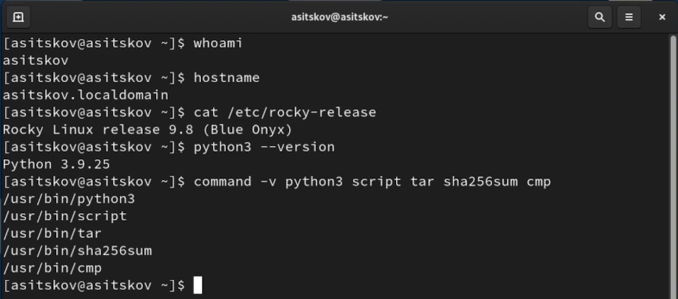{#fig-environment width=95%}

## Рабочий каталог и журнал

Создал уникальную папку и каталоги issuer, attacker, evidence. Включил журнал script и приглашение с именем пользователя.

```bash
LAB08_DIR="$(mktemp -d "$HOME/lab08-XXXXXXXX")"
export LAB08_DIR
cd \
    -- "$LAB08_DIR"
pwd
mkdir issuer attacker evidence
export PYTHONIOENCODING=utf-8
script -q -f session.log
export PS1='[\u@\h \W]$ '
pwd
whoami
ls -d issuer attacker evidence
```

Рабочий путь — /home/asitskov/lab08-CaYHzeLq. Все действия выполняются от asitskov; журнал пишется в session.log. Результат показан на @fig-workdir-log.

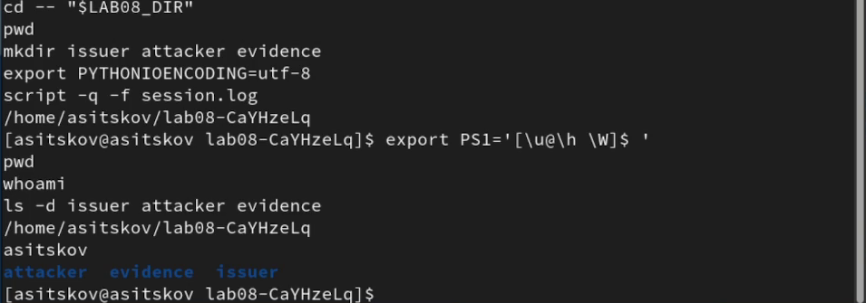{#fig-workdir-log width=95%}

## Создание и проверка приложения

Сохранил keyreuse.py через heredoc. Приложение имеет пять режимов: encrypt/decrypt для известного ключа, xor/recover для наблюдателя и table для проверки равенства. Аргументы и справку формирует argparse [@python_argparse]. Длины проверяются до XOR, сохранение с режимом x исключает перезапись результатов.

```bash
python3 -c "from pathlib import Path; compile(Path('keyreuse.py').read_text(encoding='utf-8'), 'keyreuse.py', 'exec'); print('Синтаксис Python: OK')"
sha256sum keyreuse.py
python3 keyreuse.py \
    --help
```

Синтаксис проверен успешно. SHA-256 совпал с исходником:

```text
a768cabf5ccbfb75bc639e53ef50b7aebef231eec8645cb01f07e727ab04c857
```

Полный код приведён в приложении. Результат показан на @fig-code-check.

{#fig-code-check width=95%}

## Подготовка исходных данных

Создал в issuer файлы p1.txt, p2.txt и key.hex. Телеграммы сохраняются без завершающего перевода строки.

```python
from pathlib import Path
p1 = 'НаВашисходящийот1204'
p2 = 'ВСеверныйфилиалБанка'
key = '05 0C 17 7F 0E 4E 37 D2 94 10 09 2E 22 57 FF C8 0B B2 70 54'
for name, value in [('p1.txt', p1), ('p2.txt', p2), ('key.hex', key + '\n')]:
    with open(Path('issuer') / name, 'x', encoding='utf-8') as stream:
        stream.write(value)
print('P1:', p1)
print('P2:', p2)
print('Ключ HEX:', key)
print('Длины в cp1251:', len(p1.encode('cp1251')), len(p2.encode('cp1251')))
print('Длина ключа:', len(bytes.fromhex(key)))
assert len(p1.encode('cp1251')) == len(p2.encode('cp1251')) == len(bytes.fromhex(key)) == 20
```

Обе строки и ключ имеют длину 20 байт. В ключе использован байт 0B; запись OB в методичке исправлена как недопустимая HEX-пара. Исходные данные показаны на @fig-inputs.

{#fig-inputs width=95%}

## Шифрование первой телеграммы

Вычислил C1 = P1 XOR K и сохранил результат в HEX.

```bash
python3 keyreuse.py encrypt \
    --text-file issuer/p1.txt \
    --key-file issuer/key.hex \
    --out issuer/c1.hex
```

C1 = C8 EC D5 9F F6 A6 C6 27 7A F4 F6 D7 CA BE 11 3A 3A 80 40 60. Длины P, K, C равны 20 байтам. Результат показан на @fig-encrypt-p1.

{#fig-encrypt-p1 width=95%}

## Шифрование второй телеграммы

Зашифровал P2 тем же файлом ключа, начиная с того же байта гаммы.

```bash
python3 keyreuse.py encrypt \
    --text-file issuer/p2.txt \
    --key-file issuer/key.hex \
    --out issuer/c2.hex
```

C2 = C7 DD F2 9D EB BE DA 29 7D E4 E1 C5 CA B7 14 09 EB 5F 9A B4. Длины снова 20/20/20. Результат показан на @fig-encrypt-p2.

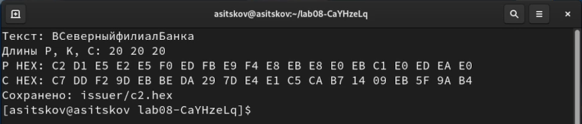{#fig-encrypt-p2 width=95%}

## Расшифрование первой телеграммы

Применил XOR с известным ключом и сравнил текстовые файлы.

```bash
python3 keyreuse.py decrypt \
    --cipher-file issuer/c1.hex \
    --key-file issuer/key.hex \
    --out issuer/p1-decoded.txt
cmp issuer/p1.txt issuer/p1-decoded.txt
echo "P1 cmp exit=$?"
```

Получил НаВашисходящийот1204; сравнение завершилось с кодом 0. Результат показан на @fig-decrypt-p1.

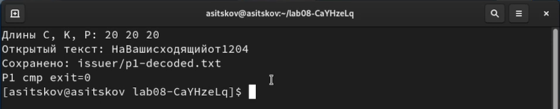{#fig-decrypt-p1 width=95%}

## Расшифрование второй телеграммы

Аналогично проверил обратимость для второй строки.

```bash
python3 keyreuse.py decrypt \
    --cipher-file issuer/c2.hex \
    --key-file issuer/key.hex \
    --out issuer/p2-decoded.txt
cmp issuer/p2.txt issuer/p2-decoded.txt
echo "P2 cmp exit=$?"
```

Получил ВСеверныйфилиалБанка; сравнение завершилось с кодом 0. Результат показан на @fig-decrypt-p2.

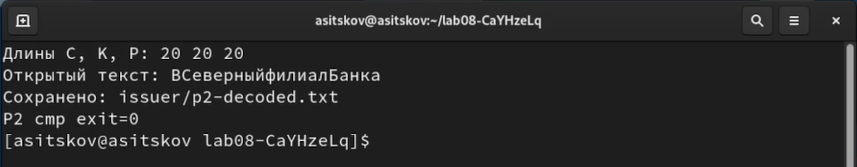{#fig-decrypt-p2 width=95%}

## Побайтовая проверка исчезновения гаммы

Создал таблицу 20 позиций по исходным текстам и шифротекстам. Это проверка формулы на данных отправителя.

```bash
python3 keyreuse.py table \
    --p1-file issuer/p1.txt \
    --p2-file issuer/p2.txt \
    --c1-file issuer/c1.hex \
    --c2-file issuer/c2.hex \
    --out evidence/xor-table.tsv
sed -n '1,11p' evidence/xor-table.tsv
```

Равенство C1 XOR C2 = P1 XOR P2 дало True. В каждой позиции последние два HEX-значения совпадают. Результат показан на @fig-table-first.

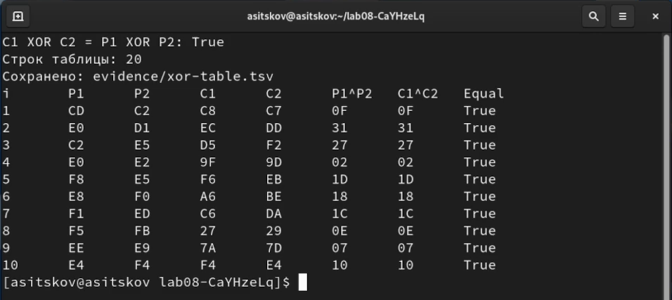{#fig-table-first width=95%}

## Вторая половина таблицы

Показал оставшиеся десять строк вместе с заголовком.

```bash
sed -n '1p;12,21p' evidence/xor-table.tsv
```

Для позиций 11–20 равенство также выполняется. Результат показан на @fig-table-second.

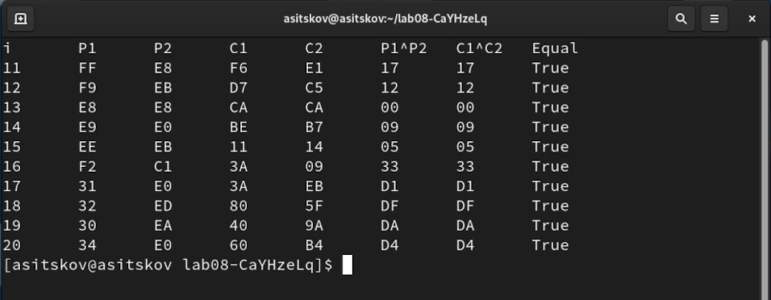{#fig-table-second width=95%}

В @tbl-byte-xor приведены все позиции. Например, для позиции 1: CD XOR C2 = 0F и C8 XOR C7 = 0F.

| i | P1 | P2 | C1 | C2 | P1 XOR P2 | C1 XOR C2 |
|---:|---|---|---|---|---|---|
| 1 | CD | C2 | C8 | C7 | 0F | 0F |
| 2 | E0 | D1 | EC | DD | 31 | 31 |
| 3 | C2 | E5 | D5 | F2 | 27 | 27 |
| 4 | E0 | E2 | 9F | 9D | 02 | 02 |
| 5 | F8 | E5 | F6 | EB | 1D | 1D |
| 6 | E8 | F0 | A6 | BE | 18 | 18 |
| 7 | F1 | ED | C6 | DA | 1C | 1C |
| 8 | F5 | FB | 27 | 29 | 0E | 0E |
| 9 | EE | E9 | 7A | 7D | 07 | 07 |
| 10 | E4 | F4 | F4 | E4 | 10 | 10 |
| 11 | FF | E8 | F6 | E1 | 17 | 17 |
| 12 | F9 | EB | D7 | C5 | 12 | 12 |
| 13 | E8 | E8 | CA | CA | 00 | 00 |
| 14 | E9 | E0 | BE | B7 | 09 | 09 |
| 15 | EE | EB | 11 | 14 | 05 | 05 |
| 16 | F2 | C1 | 3A | 09 | 33 | 33 |
| 17 | 31 | E0 | 3A | EB | D1 | D1 |
| 18 | 32 | ED | 80 | 5F | DF | DF |
| 19 | 30 | EA | 40 | 9A | DA | DA |
| 20 | 34 | E0 | 60 | B4 | D4 | D4 |

: Побайтовая проверка XOR для двух телеграмм {#tbl-byte-xor}

## Входные данные наблюдателя

Скопировал в attacker только программу и два шифротекста. Режим recover не имеет параметра ключа; в программе нет встроенных P1/P2/K.

```bash
cp \
    -- keyreuse.py issuer/c1.hex issuer/c2.hex attacker/
cd attacker
pwd
ls -1
python3 keyreuse.py recover \
    --help
```

В папке были c1.hex, c2.hex, keyreuse.py. Дальнейшее восстановление не читает issuer/key.hex. Это моделирование входов наблюдателя, а не настройка изоляции доступа Linux. Результат показан на @fig-observer-inputs.

{#fig-observer-inputs width=95%}

## XOR двух шифротекстов

Получил связь между открытыми текстами без использования ключа.

```bash
python3 keyreuse.py xor \
    --c1-file c1.hex \
    --c2-file c2.hex \
    --out combined.hex
```

C1 XOR C2 = 0F 31 27 02 1D 18 1C 0E 07 10 17 12 00 09 05 33 D1 DF DA D4. Сам результат XOR пока не является одной из телеграмм. Результат показан на @fig-cipher-xor.

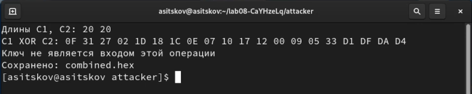{#fig-cipher-xor width=95%}

## Известный шаблон первой телеграммы

Применил известное 16-байтовое начало НаВашисходящийот на смещении 0. Четыре цифры поля в команду не вводил.

```bash
python3 keyreuse.py recover \
    --c1-file c1.hex \
    --c2-file c2.hex \
    --known-text 'НаВашисходящийот' \
    --offset 0 \
    --out p2-prefix.txt
```

Восстановлен фрагмент ВСеверныйфилиалБ. Полная маска — ВСеверныйфилиалБ????; четыре позиции ещё неизвестны. Результат показан на @fig-known-prefix.

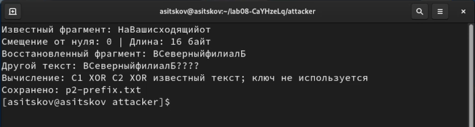{#fig-known-prefix width=95%}

## Предположение о слове Банка

По смыслу восстановленного начала предположил конец Банка. Его первая буква расположена на позиции 16 при счёте с единицы, то есть на смещении 15 от нуля.

```bash
python3 keyreuse.py recover \
    --c1-file c1.hex \
    --c2-file c2.hex \
    --known-text 'Банка' \
    --offset 15 \
    --out p1-tail.txt
```

Получен хвост P1: т1204. Буква т совпадает с концом известного шаблона. Это согласование гипотезы; подлинность текста проверяется отдельно сравнением с оригиналом. Результат показан на @fig-known-tail.

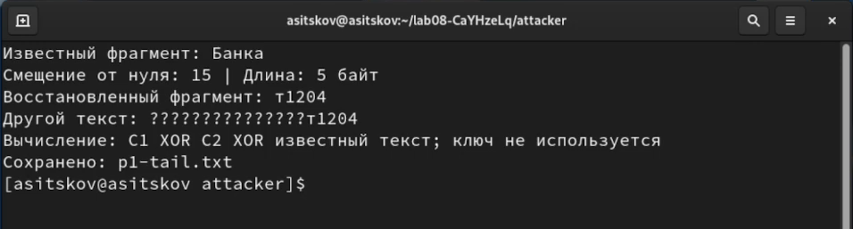{#fig-known-tail width=95%}

## Сборка полного первого сообщения

Объединил известный шаблон с восстановленным хвостом. Перекрывающуюся букву т включил один раз.

```python
from pathlib import Path
prefix = 'НаВашисходящийот'
tail = Path('p1-tail.txt').read_text(encoding='utf-8')
assert len(prefix.encode('cp1251')) == 16
assert len(tail.encode('cp1251')) == 5
assert prefix[-1] == tail[0]
p1 = prefix[:-1] + tail
assert len(p1.encode('cp1251')) == 20
with open('p1-restored.txt', 'x', encoding='utf-8') as stream:
    stream.write(p1)
print('Совпадение на перекрывающейся позиции:', prefix[-1] == tail[0])
print('Собранный P1:', p1)
print('Длина P1 в cp1251:', len(p1.encode('cp1251')))
```

Проверка перекрытия дала True. Собран текст НаВашисходящийот1204 длиной 20 байт (@fig-assemble-p1).

{#fig-assemble-p1 width=95%}

## Полное восстановление второго сообщения

Использовал собранный P1 как известный текст. В вычислении участвуют только C1, C2 и P1.

```bash
python3 keyreuse.py recover \
    --c1-file c1.hex \
    --c2-file c2.hex \
    --known-file p1-restored.txt \
    --offset 0 \
    --out p2-restored.txt
```

Получен полный текст ВСеверныйфилиалБанка без неизвестных позиций. Результат показан на @fig-recover-p2.

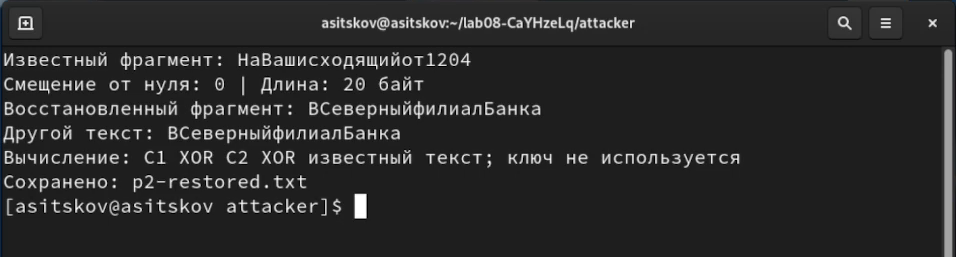{#fig-recover-p2 width=95%}

## Обратное восстановление первого сообщения

Проверил симметричную формулу с восстановленным P2.

```bash
python3 keyreuse.py recover \
    --c1-file c1.hex \
    --c2-file c2.hex \
    --known-file p2-restored.txt \
    --offset 0 \
    --out p1-recovered.txt
cmp p1-restored.txt p1-recovered.txt
echo "Обратная проверка cmp exit=$?"
```

Получен НаВашисходящийот1204; обратное сравнение завершилось с кодом 0. Результат показан на @fig-recover-p1.

{#fig-recover-p1 width=95%}

## Сравнение с оригиналами

После завершения восстановления вернулся в корень и сравнил оба результата с исходными учебными телеграммами.

```bash
cd ..
pwd
cmp issuer/p1.txt attacker/p1-restored.txt
echo "P1 собранный совпал: cmp exit=$?"
cmp issuer/p1.txt attacker/p1-recovered.txt
echo "P1 обратный совпал: cmp exit=$?"
cmp issuer/p2.txt attacker/p2-restored.txt
echo "P2 совпал: cmp exit=$?"
```

Все три сравнения дали код 0. Для заданных исходных данных смысловая гипотеза верна. Обратное XOR-преобразование само по себе лишь проверяло согласованность, а не подлинность догадки. Результат показан на @fig-compare-originals.

{#fig-compare-originals width=95%}

## Аналитический способ восстановления

Сохранил формулы и пояснение границ метода в evidence/analysis.txt.

```bash
cat evidence/analysis.txt
```

Ключ исключается при XOR шифротекстов. Известные позиции одного текста раскрывают соответствующие позиции другого; новые догадки можно применять последовательно. Результат показан на @fig-analysis.

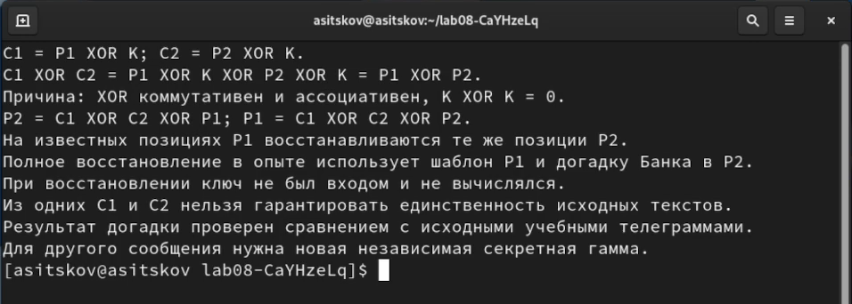{#fig-analysis width=95%}

## Итоговая проверка файлов

Проверил сохранённые результаты, равенство XOR и оба пути восстановления. Ключ этому проверочному блоку не требуется.

```python
from pathlib import Path
def text(name):
    return Path(name).read_text(encoding='utf-8')
def hx(name):
    return bytes.fromhex(text(name))
p1 = text('issuer/p1.txt').encode('cp1251')
p2 = text('issuer/p2.txt').encode('cp1251')
c1 = hx('issuer/c1.hex')
c2 = hx('issuer/c2.hex')
assert len(p1) == len(p2) == len(c1) == len(c2) == 20
checks = {
    'P1 после расшифрования': text('issuer/p1-decoded.txt') == text('issuer/p1.txt'),
    'P2 после расшифрования': text('issuer/p2-decoded.txt') == text('issuer/p2.txt'),
    'C1 XOR C2 = P1 XOR P2': bytes(a ^ b for a, b in zip(c1, c2)) == bytes(a ^ b for a, b in zip(p1, p2)),
    'Сохранённый XOR': hx('attacker/combined.hex') == bytes(a ^ b for a, b in zip(c1, c2)),
    'P1 из фрагментов': text('attacker/p1-restored.txt') == text('issuer/p1.txt'),
    'P2 без ключа': text('attacker/p2-restored.txt') == text('issuer/p2.txt'),
    'P1 без ключа': text('attacker/p1-recovered.txt') == text('issuer/p1.txt'),
}
lines = [name + ': ' + str(value) for name, value in checks.items()]
with open('evidence/verification.txt', 'x', encoding='utf-8') as stream:
    stream.write('\n'.join(lines) + '\n')
print('\n'.join(lines))
assert all(checks.values())
```

Все семь проверок дали True, исключений не возникло (@fig-verification).

{#fig-verification width=95%}

## Отказ при коротком ключе

Проверил сообщение длиной 20 байт с ключом длиной 2 байта.

```bash
printf '%s\n' '05 0C' > evidence/short-key.hex
python3 keyreuse.py encrypt \
    --text-file issuer/p1.txt \
    --key-file evidence/short-key.hex \
    --out evidence/should-not-exist.hex
echo "Ожидаемый отказ exit=$?"
test ! -e evidence/should-not-exist.hex
echo "Неверный результат не создан: test exit=$?"
```

Приложение сообщило «Длины не совпадают: 20 и 2 байт» и вернуло код 1. Проверка отсутствия выходного файла дала код 0. Ключ не повторяется циклически и сообщение не усекается (@fig-short-key-error).

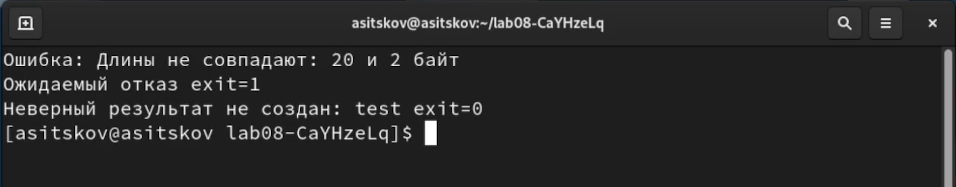{#fig-short-key-error width=95%}

## Завершение журнала и сохранение материалов

Завершил оболочку script отдельной командой exit, проверил каталог и состав файлов.

```bash
exit
cd \
    -- "$LAB08_DIR"
pwd
whoami
ls -lh keyreuse.py session.log
find issuer attacker evidence -maxdepth 1 -type f | sort
```

Журнал непустой, размер показан как 44 КБ. Каталоги issuer, attacker, evidence содержат соответственно 7, 9 и 4 файла (@fig-files-log).

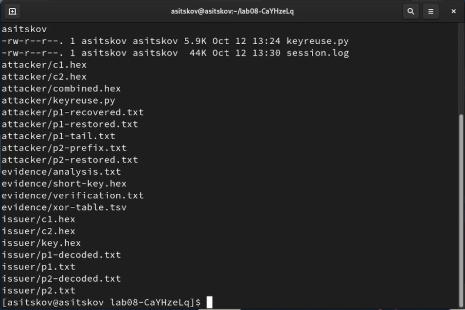{#fig-files-log width=95%}

После закрытия журнала собрал гостевой архив.

```bash
tar -czf lab08-evidence.tar.gz keyreuse.py session.log issuer attacker evidence
tar -tzf lab08-evidence.tar.gz
sha256sum lab08-evidence.tar.gz
ls -lh lab08-evidence.tar.gz
```

Архив создан в /home/asitskov/lab08-CaYHzeLq; показанный размер — 11 КБ. Просмотр содержимого и вычисление SHA-256 завершились без ошибки (@fig-archive).

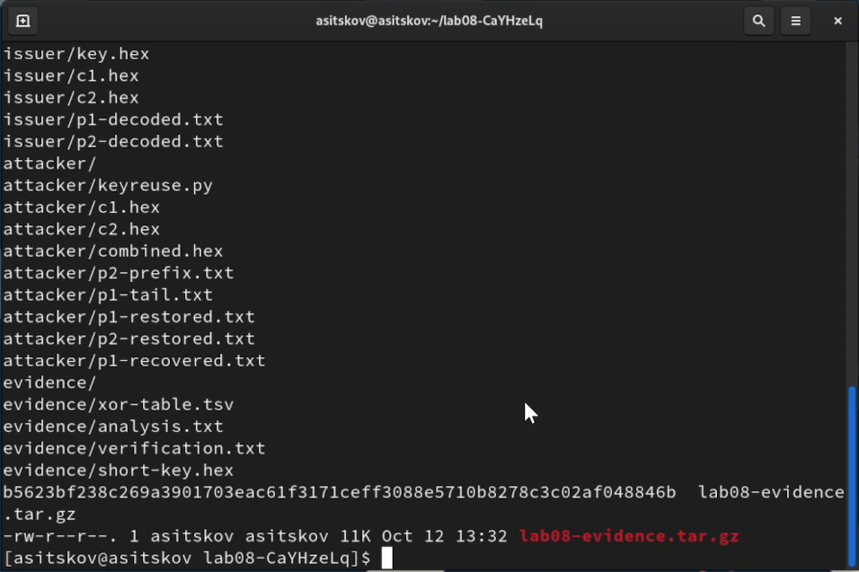{#fig-archive width=95%}


# Анализ результатов

Получены два 20-байтовых шифротекста и подтверждена обратимость XOR с ключом. Во всех 20 позициях равенство $C_1\oplus C_2=P_1\oplus P_2$ выполняется. Наблюдатель прочитал обе телеграммы, используя два шифротекста, известный шаблон первой и проверяемое предположение о конце второй. Ключ в операциях восстановления не передавался и не определялся.

Известный фрагмент раскрывает столько позиций другого сообщения, сколько байтов в нём известно. В начале удалось прочитать 16 позиций P2. Предположение о последних пяти позициях P2 раскрыло хвост P1, включая четыре цифры поля. Проверка с оригиналами показала правильность именно этой догадки. Из двух шифротекстов без дополнительных сведений нельзя гарантировать однозначное чтение.

Использована кодировка cp1251, сохраняющая заданную длину русских сообщений. Исправлена недопустимая HEX-пара OB на 0B. Исходные тексты не дополнены и не усечены. Защита приложения от несовпадения длин сработала до формирования результата.

# Ответы на контрольные вопросы

## Определение другого текста без ключа

Зная P1 и два шифротекста, вычисляют $P_2=C_1\oplus C_2\oplus P_1$. При известном P2 используется симметричное равенство. Для известного фрагмента формула применяется на тех же позициях гаммы; остальные байты остаются неизвестными [@rudn_lab8].

## Повторное использование ключа

Повторение гаммы раскрывает XOR открытых текстов, потому что одинаковый ключ сокращается. Известные шаблоны и догадки позволяют читать связанные позиции второго сообщения. При этом информационная стойкость одноразового блокнота теряется [@rudn_lab8].

## Реализация кодирования двух текстов

Оба текста кодируются в байты одной кодировки. В каждой позиции вычисляются $C_1[i]=P_1[i]\oplus K[i]$ и $C_2[i]=P_2[i]\oplus K[i]$. Обратная операция с тем же K возвращает исходные байты. В опыте сообщения и ключ равны по длине, гамма в обоих случаях применяется с начала.

## Недостатки повторения гаммы

Утекает связь между открытыми текстами; знание одного фрагмента раскрывает соответствующий фрагмент другого. Форматные сообщения уязвимы к анализу шаблонов и смысловых вариантов. Сам XOR не обеспечивает целостность: изменение бита шифротекста меняет тот же бит восстановленного текста при отсутствии отдельной аутентификации.

## Преимущества повторения гаммы

Повторение уменьшает объём передаваемого и хранимого ключевого материала. Операция XOR проста и быстра, но это свойство сохраняется и при корректном одноразовом применении. Криптографического преимущества повторение гаммы не даёт; экономия ключевого материала сопровождается потерей защищённости.

# Выводы

Разработал приложение с режимами шифрования, расшифрования, XOR двух шифротекстов, восстановления по известному фрагменту и построения таблицы. Зашифровал заданные телеграммы одним ключом, проверил обычное расшифрование и прочитал оба сообщения без использования ключа по шаблону и смысловой гипотезе. Все сравнения с оригиналами и итоговые проверки прошли. Аналитически показал сокращение одинаковой гаммы и утечку связи между текстами. Для другого сообщения нужен новый независимый секретный ключ. Цель работы достигнута.

# Список литературы {.unnumbered}

::: {#refs}
:::

# Приложение {.unnumbered}

## Исходный код программы {.unnumbered}

```python
import argparse
import sys
from pathlib import Path


ENCODING = 'cp1251'


def read_text(name):
    return Path(name).read_text(encoding='utf-8')


def read_hex(name):
    value = bytes.fromhex(read_text(name))
    if not value:
        raise ValueError('HEX-файл пуст')
    return value


def to_bytes(value):
    result = value.encode(ENCODING)
    if not result:
        raise ValueError('Текст пуст')
    return result


def xor_equal(left, right):
    if len(left) != len(right):
        raise ValueError('Длины не совпадают: {} и {} байт'.format(len(left), len(right)))
    if not left:
        raise ValueError('Пустые данные')
    return bytes(a ^ b for a, b in zip(left, right))


def hex_line(value):
    return ' '.join('{:02X}'.format(item) for item in value)


def save_text(name, value):
    with open(name, 'x', encoding='utf-8') as stream:
        stream.write(value)


def save_hex(name, value):
    save_text(name, hex_line(value) + '\n')


def build_parser():
    parser = argparse.ArgumentParser(description='ЛР 8: повторное применение XOR-гаммы')
    commands = parser.add_subparsers(dest='mode', required=True)
    encrypt = commands.add_parser('encrypt', help='Шифрование с известным ключом')
    encrypt.add_argument('--text-file', required=True)
    encrypt.add_argument('--key-file', required=True)
    encrypt.add_argument('--out', required=True)
    decrypt = commands.add_parser('decrypt', help='Расшифрование с известным ключом')
    decrypt.add_argument('--cipher-file', required=True)
    decrypt.add_argument('--key-file', required=True)
    decrypt.add_argument('--out', required=True)
    mixed = commands.add_parser('xor', help='C1 XOR C2 без ключа')
    recover = commands.add_parser('recover', help='Другой текст по известному фрагменту')
    table = commands.add_parser('table', help='Таблица равенства C1 XOR C2 = P1 XOR P2')
    for command in (mixed, recover, table):
        command.add_argument('--c1-file', required=True)
        command.add_argument('--c2-file', required=True)
        command.add_argument('--out', required=True)
    known = recover.add_mutually_exclusive_group(required=True)
    known.add_argument('--known-text')
    known.add_argument('--known-file')
    recover.add_argument('--offset', type=int, default=0)
    table.add_argument('--p1-file', required=True)
    table.add_argument('--p2-file', required=True)
    return parser


def run(args):
    if args.mode == 'encrypt':
        plain = to_bytes(read_text(args.text_file))
        key = read_hex(args.key_file)
        cipher = xor_equal(plain, key)
        save_hex(args.out, cipher)
        print('Текст:', plain.decode(ENCODING))
        print('Длины P, K, C:', len(plain), len(key), len(cipher))
        print('P HEX:', hex_line(plain))
        print('C HEX:', hex_line(cipher))
    elif args.mode == 'decrypt':
        cipher = read_hex(args.cipher_file)
        key = read_hex(args.key_file)
        plain = xor_equal(cipher, key)
        text = plain.decode(ENCODING)
        save_text(args.out, text)
        print('Длины C, K, P:', len(cipher), len(key), len(plain))
        print('Открытый текст:', text)
    elif args.mode == 'xor':
        c1 = read_hex(args.c1_file)
        c2 = read_hex(args.c2_file)
        combined = xor_equal(c1, c2)
        save_hex(args.out, combined)
        print('Длины C1, C2:', len(c1), len(c2))
        print('C1 XOR C2:', hex_line(combined))
        print('Ключ не является входом этой операции')
    elif args.mode == 'recover':
        c1 = read_hex(args.c1_file)
        c2 = read_hex(args.c2_file)
        combined = xor_equal(c1, c2)
        known_text = args.known_text
        if args.known_file is not None:
            known_text = read_text(args.known_file)
        known = to_bytes(known_text)
        start = args.offset
        end = start + len(known)
        if start < 0 or end > len(combined):
            raise ValueError('Фрагмент выходит за границы шифротекстов')
        recovered = xor_equal(combined[start:end], known).decode(ENCODING)
        save_text(args.out, recovered)
        print('Известный фрагмент:', known_text)
        print('Смещение от нуля:', start, '| Длина:', len(known), 'байт')
        print('Восстановленный фрагмент:', recovered)
        print('Другой текст:', '?' * start + recovered + '?' * (len(combined) - end))
        print('Вычисление: C1 XOR C2 XOR известный текст; ключ не используется')
    elif args.mode == 'table':
        p1 = to_bytes(read_text(args.p1_file))
        p2 = to_bytes(read_text(args.p2_file))
        c1 = read_hex(args.c1_file)
        c2 = read_hex(args.c2_file)
        plain_xor = xor_equal(p1, p2)
        cipher_xor = xor_equal(c1, c2)
        xor_equal(p1, c1)
        if plain_xor != cipher_xor:
            raise ValueError('Равенство C1 XOR C2 = P1 XOR P2 не выполнено')
        lines = ['i\tP1\tP2\tC1\tC2\tP1^P2\tC1^C2\tEqual']
        for i, values in enumerate(zip(p1, p2, c1, c2, plain_xor, cipher_xor), 1):
            lines.append(str(i) + '\t' + '\t'.join('{:02X}'.format(v) for v in values) + '\tTrue')
        save_text(args.out, '\n'.join(lines) + '\n')
        print('C1 XOR C2 = P1 XOR P2:', plain_xor == cipher_xor)
        print('Строк таблицы:', len(p1))
    print('Сохранено:', args.out)


def main():
    args = build_parser().parse_args()
    try:
        run(args)
    except (OSError, ValueError) as error:
        print('Ошибка:', error, file=sys.stderr)
        return 1
    return 0


if __name__ == '__main__':
    sys.exit(main())
```
